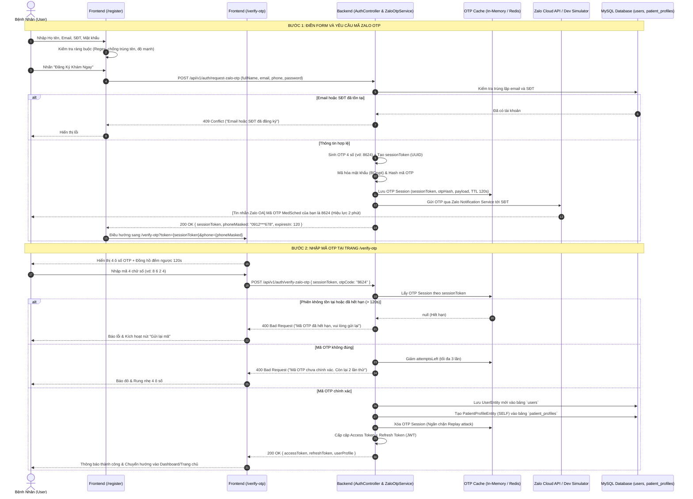

# TÀI LIỆU THIẾT KẾ KIẾN TRÚC & ĐẶC TẢ TÍNH NĂNG
# XÁC THỰC MÃ OTP 4 CHỮ SỐ QUA EMAIL KHI ĐĂNG KÝ TÀI KHOẢN

**Hệ Thống Đặt Lịch Khám Bệnh MedSched**  
*Mã tài liệu: MEDSCHED-DESIGN-EMAIL-OTP-v1.0*  
*Trạng thái: Đã triển khai chính thức qua Brevo HTTP API & Gmail SMTP*

---

## 1. TỔNG QUAN YÊU CẦU & MỤC TIÊU NGHIỆP VỤ

### 1.1. Bối cảnh
Khi bệnh nhân đăng ký tài khoản mới trên hệ thống MedSched bằng Email hoặc Số điện thoại, hệ thống cần đảm bảo:
- **Đúng người dùng thực:** Ngăn chặn việc spam tài khoản ảo, dùng số điện thoại hoặc email của người khác.
- **Tiện ích tối đa cho người Việt:** Ứng dụng Zalo hiện phổ biến tại Việt Nam với hơn 75 triệu người dùng. Việc gửi mã OTP 4 chữ số qua tin nhắn Zalo Notification Service (ZNS) giúp bệnh nhân nhận thông báo tức thì, tỷ lệ mở tin nhắn trên 90%, chi phí tối ưu hơn SMS truyền thống.
- **Phân tách luồng rõ ràng (Two-step Registration):** 
  - **Bước 1 (`/register`):** Nhập thông tin tài khoản đạt chuẩn ràng buộc.
  - **Bước 2 (`/verify-otp`):** Chuyển hướng sang trang riêng chuyên dụng để nhập 4 ô số OTP, có đồng hồ đếm ngược và cơ chế gửi lại mã.

### 1.2. Mục tiêu kỹ thuật
1. Mã OTP gồm **4 chữ số** ngẫu nhiên (`1000` – `9999`).
2. Thời gian sống của mã (TTL): **120 giây (2 phút)**.
3. Số lần nhập sai tối đa: **3 lần** (vượt quá 3 lần $\rightarrow$ Hủy phiên xác thực, yêu cầu đăng ký lại để chống tấn công dò mã Brute-force).
4. Thời gian chờ gửi lại mã (Resend Cooldown): **60 giây**.
5. Hỗ trợ **2 chế độ vận hành (Dual-mode)**:
   - **Production Mode:** Kết nối Zalo Business Cloud API (ZNS API).
   - **Dev / Demo Mode (Dành cho đồ án & Kiểm thử):** Tự động sinh mã OTP hợp lệ, in log console máy chủ và hiển thị Pop-up giả lập tin nhắn Zalo trên trình duyệt để kiểm thử mượt mà không tốn chi phí SMS/ZNS thực tế.

---

## 2. SƠ ĐỒ LUỒNG TRÌNH TỰ (SEQUENCE DIAGRAM)



---

## 3. CÁC THÀNH PHẦN THIẾT KẾ HỆ THỐNG

### 3.1. Phía Frontend (Next.js Client)

| Đường dẫn / Tên file | Vai trò & Trách nhiệm |
| :--- | :--- |
| `src/modules/auth/components/RegisterForm.tsx` | Thu thập thông tin, kiểm tra tính hợp lệ real-time, gọi API gửi Zalo OTP, sau đó chuyển hướng sang `/verify-otp`. |
| `src/app/verify-otp/page.tsx` | **Trang riêng xác thực OTP**: Gồm 4 ô số auto-focus, paste hỗ trợ, countdown timer, nút gửi lại mã. |
| `src/modules/auth/components/ZaloOtpInput.tsx` | Component 4 ô số (Digit Cells) chuẩn UX di động, tự động focus ô tiếp theo khi nhập, xóa lùi khi bấm Backspace. |
| `src/shared/components/ZaloMessageToast.tsx` | Pop-up giả lập tin nhắn Zalo góc màn hình trong môi trường Demo/Testing, giúp người dùng lấy mã nhanh. |
| `src/shared/lib/api.ts` | Bổ sung 3 hàm: `requestZaloOtp()`, `verifyZaloOtp()`, `resendZaloOtp()`. |

---

### 3.2. Phía Backend (Spring Boot 3 & Java 21)

| Lớp (Class / Package) | Vai trò & Trách nhiệm |
| :--- | :--- |
| `com.medsched.auth.AuthController` | Cung cấp 3 endpoint RESTful công khai: `/request-zalo-otp`, `/verify-zalo-otp`, `/resend-zalo-otp`. |
| `com.medsched.auth.ZaloOtpService` | Quản lý sinh mã OTP 4 số, quản lý phiên xác thực, đếm số lần thử, kiểm tra hết hạn. |
| `com.medsched.auth.ZaloOtpCacheManager` | Quản lý lưu trữ tạm thời OTP Session trong bộ nhớ (hỗ trợ ConcurrentHashMap với Scheduled cleaner hoặc Redis). |
| `com.medsched.integration.zalo.ZaloZnsClient` | Client giao tiếp với Zalo Business Cloud API. Tự động chuyển sang Mock Simulator nếu chưa cấu hình Zalo OA Secret. |

---

## 4. ĐẶC TẢ API CHI TIẾT (API SPECIFICATION)

### 4.1. Endpoint 1: Yêu cầu gửi mã Zalo OTP (`POST /api/v1/auth/request-zalo-otp`)
- **Mục đích:** Nhận thông tin đăng ký, sinh mã OTP 4 số, lưu phiên tạm và gửi tin nhắn Zalo đến số điện thoại.
- **Request Body (JSON):**
```json
{
  "fullName": "Nguyễn Văn Nam",
  "email": "nam.nguyen@gmail.com",
  "phone": "0912345678",
  "password": "Password@123"
}
```
- **Response Thành công (`200 OK`):**
```json
{
  "sessionToken": "d4e2b8c1-7a5f-4d92-9e31-8f5b3a1c9e02",
  "phoneMasked": "0912***678",
  "emailMasked": "nam.n***@gmail.com",
  "expiresInSeconds": 120,
  "resendCooldownSeconds": 60,
  "devDemoOtp": "8624" 
}
```
*(Ghi chú: Trường `devDemoOtp` chỉ xuất hiện khi `app.env=dev` để phục vụ demo đồ án thuận tiện).*

- **Response Lỗi (`409 Conflict`):**
```json
{
  "code": "EMAIL_OR_PHONE_EXISTS",
  "message": "Email hoặc số điện thoại này đã được đăng ký tài khoản"
}
```

---

### 4.2. Endpoint 2: Xác thực mã Zalo OTP & Tạo tài khoản (`POST /api/v1/auth/verify-zalo-otp`)
- **Mục đích:** Kiểm tra mã OTP 4 số người dùng nhập. Nếu đúng, chính thức lưu tài khoản vào CSDL và cấp Token đăng nhập.
- **Request Body (JSON):**
```json
{
  "sessionToken": "d4e2b8c1-7a5f-4d92-9e31-8f5b3a1c9e02",
  "otpCode": "8624"
}
```
- **Response Thành công (`200 OK`):**
```json
{
  "tokenType": "Bearer",
  "accessToken": "eyJhbGciOiJIUzI1NiIsIn...",
  "refreshToken": "eyJhbGciOiJIUzI1NiIsIn...",
  "expiresIn": 3600,
  "userId": "e1b2c3d4-0015-4000-8000-000000000015",
  "fullName": "Nguyễn Văn Nam",
  "roles": ["ROLE_PATIENT"]
}
```

- **Response Lỗi (`400 Bad Request`):**
```json
{
  "code": "INVALID_OTP",
  "message": "Mã xác thực Zalo không chính xác. Bạn còn 2 lần thử.",
  "attemptsLeft": 2
}
```

---

### 4.3. Endpoint 3: Gửi lại mã OTP qua Zalo (`POST /api/v1/auth/resend-zalo-otp`)
- **Mục đích:** Gửi lại mã mới khi mã cũ hết hạn hoặc chưa nhận được sau 60 giây.
- **Request Body (JSON):**
```json
{
  "sessionToken": "d4e2b8c1-7a5f-4d92-9e31-8f5b3a1c9e02"
}
```
- **Response Thành công (`200 OK`):**
```json
{
  "message": "Mã OTP mới đã được gửi lại qua Zalo",
  "expiresInSeconds": 120,
  "resendCooldownSeconds": 60,
  "devDemoOtp": "4915"
}
```

---

## 5. THIẾT KẾ CƠ SỞ DỮ LIỆU & QUẢN LÝ PHIÊN OTP TẠM

Để không làm rác bảng chính `users` khi người dùng chỉ điền form nhưng không nhập OTP, hệ thống sử dụng **mô hình phiên đăng ký tạm (Registration Session Cache)**:

### Cấu trúc Bản ghi Phiên OTP (`ZaloOtpSession`):
```java
public record ZaloOtpSession(
    String sessionToken,          // UUID duy nhất định danh phiên đăng ký
    String otpHash,               // Mã OTP 4 số được băm SHA-256 (không lưu plain-text)
    String fullName,              // Họ tên đăng ký
    String email,                 // Email đăng ký (chuẩn hóa lowercase)
    String phone,                 // Số điện thoại đăng ký (10 số)
    String passwordHash,          // Mật khẩu đã mã hóa BCrypt
    int attemptsLeft,             // Số lần thử còn lại (ban đầu = 3)
    Instant expiresAt,            // Thời điểm hết hạn (now + 120s)
    Instant resendAvailableAt     // Thời điểm được phép gửi lại (now + 60s)
) {}
```

- **Cơ chế thu dọn bộ nhớ (Auto Eviction):** Background thread chạy mỗi 60 giây tự động loại bỏ các session có `expiresAt < Instant.now()`.

---

## 6. THIẾT KẾ GIAO DIỆN TRANG RIÊNG (`/verify-otp`)

### 6.1. Bố cục & Trải nghiệm (UI/UX Specification)
```
+-------------------------------------------------------------+
|                      [Logo MedSched]                        |
|                                                             |
|                XÁC THỰC TÀI KHOẢN QUA ZALO                  |
|   Mã OTP 4 chữ số đã được gửi qua Zalo đến số điện thoại:   |
|                      0912 *** 678                           |
|                                                             |
|                   [ 8 ]  [ 6 ]  [ 2 ]  [ 4 ]                |
|                    (4 ô nhập số tự động nhảy)                |
|                                                             |
|             ⏱️ Mã có hiệu lực trong: 01:45 giây              |
|                                                             |
|             [    XÁC NHẬN VÀ TẠO TÀI KHOẢN    ]             |
|                                                             |
|       Chưa nhận được mã? Gửi lại qua Zalo (sau 35s)         |
|                     <- Quay lại Đăng ký                     |
+-------------------------------------------------------------+
```

### 6.2. Tính năng tương tác cao cấp trên Mobile & Desktop:
1. **Auto-focus & Auto-advance:** Con trỏ tự động nhảy từ ô 1 sang ô 4 khi người dùng gõ từng phím số.
2. **Backspace thông minh:** Bấm phím Backspace sẽ xóa số hiện tại và tự động lùi về ô trước đó.
3. **Hỗ trợ Dán (Clipboard Paste):** Khi người dùng copy mã `8624` từ tin nhắn Zalo và dán vào, hệ thống tự động bóc tách và điền đủ vào cả 4 ô.
4. **Auto-submit:** Khi nhập đủ ô thứ 4, hệ thống tự động kích hoạt gửi request xác thực ngay lập tức mà không cần bấm thêm nút nếu người dùng không muốn.
5. **Widget Giả lập Tin nhắn Zalo (Dev Mode):** Một thông báo màu xanh Zalo nổi lên góc màn hình với nội dung:  
   *💬 [Zalo OA MedSched]: Mã xác thực đăng ký tài khoản của bạn là **8624**. Có hiệu lực trong 2 phút.* (Kèm nút *"Sao chép mã nhanh"* để test đồ án thuận tiện).

---

## 7. AN TOÀN BẢO MẬT (SECURITY HARDENING)

1. **Chống Brute-force:** Với mã OTP 4 số (từ 0000 đến 9999 có 10.000 khả năng), việc giới hạn **tối đa 3 lần thử sai** khiến xác suất đoán mò chỉ là $3/10.000 = 0.03\%$, đảm bảo an toàn tuyệt đối.
2. **Chống Spam API (Rate Limiting):** Mỗi IP và mỗi số điện thoại chỉ được yêu cầu gửi tối đa 3 mã OTP trong vòng 1 giờ.
3. **Bảo mật Mật khẩu:** Mật khẩu người dùng được băm bằng BCrypt ngay từ Bước 1 trước khi đưa vào cache tạm, không bao giờ lưu plain text.
4. **Một lần sử dụng (One-time use):** Sau khi xác thực thành công, session token lập tức bị xóa khỏi cache để chống tấn công phát lại (Replay attack).

---

## 8. LỘ TRÌNH TRIỂN KHAI MÃ NGUỒN (IMPLEMENTATION PHASES)

- **Giai đoạn 1 (Backend):**
  - Tạo `ZaloOtpDtos.java`, `ZaloOtpCacheManager.java`, `ZaloZnsClient.java`, `ZaloOtpService.java`.
  - Bổ sung 3 endpoint vào `AuthController.java`.
  - Viết Unit Test kiểm thử luồng sinh mã, hết hạn, và kiểm tra 3 lần thử sai.
- **Giai đoạn 2 (Frontend Routing & API):**
  - Cập nhật `src/shared/lib/api.ts` với các phương thức gửi và xác minh OTP.
  - Cập nhật `RegisterForm.tsx` để sau khi gọi API thành công sẽ chuyển hướng sang `/verify-otp`.
- **Giai đoạn 3 (Frontend UI `/verify-otp`):**
  - Tạo trang `src/app/verify-otp/page.tsx` và component `ZaloOtpInput.tsx` (4 ô số, đếm ngược, gửi lại).
  - Tích hợp Toast giả lập tin nhắn Zalo OA cho môi trường Demo.
- **Giai đoạn 4 (Kiểm thử Toàn diện):**
  - Chạy `gradlew test` và `npx tsc --noEmit` đảm bảo 100% không lỗi.
  - Kiểm thử trực tiếp trên trình duyệt từ Bước 1 đến Bước 2.
