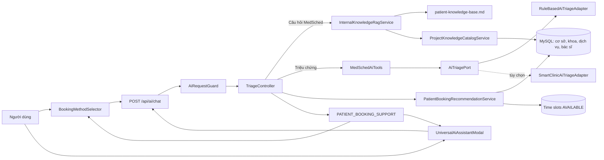

# Tổng quan AI Chatbox MedSched

> Cập nhật theo mã nguồn hiện tại ngày 28/10/2026.
> Phạm vi: kiến trúc, luồng nghiệp vụ, RAG nội bộ, sàng lọc triệu chứng, hỗ trợ đặt lịch, phân quyền, API, giao diện, cấu hình, kiểm thử và danh sách file liên quan.

## 1. Mục đích của AI Chatbox

AI Chatbox MedSched là lớp trợ lý hội thoại kết nối người dùng với dữ liệu và nghiệp vụ của hệ thống phòng khám. Chatbox hiện phục vụ bốn nhóm vai trò:

- **Bệnh nhân:** hỏi thông tin phòng khám, mô tả triệu chứng, được hỏi làm rõ, định hướng chuyên khoa và chuyển sang quy trình đặt lịch.
- **Lễ tân (`STAFF`):** tra cứu vé hẹn, bệnh nhân, hàng đợi và thực hiện check-in theo quyền.
- **Bác sĩ (`DOCTOR`):** xem tải khám, tóm tắt bệnh án, tra cứu thuốc và tham khảo sàng lọc triệu chứng.
- **Quản trị viên (`ADMIN`):** hỏi số liệu vận hành, tài khoản và thống kê hệ thống.

Chatbox là công cụ **sàng lọc và hỗ trợ nghiệp vụ**, không phải bác sĩ và không được mô tả kết quả như một chẩn đoán y khoa chính thức.

## 2. Trạng thái kỹ thuật hiện tại

Hệ thống hiện được thiết kế theo nguyên tắc **internal-first**:

1. Ưu tiên luật nghiệp vụ, dữ liệu cơ sở dữ liệu và kho tri thức nội bộ.
2. Không cần API key ngoài để chạy luồng bệnh nhân và đặt lịch cơ bản.
3. Bộ sàng lọc mặc định là `RuleBasedAiTriageAdapter`.
4. `SmartClinicAiTriageAdapter` chỉ được bật khi cấu hình rõ `app.ai.external-enabled=true`.
5. Các lớp Gemini/OpenRouter vẫn tồn tại như phương án tùy chọn, nhưng không phải đường xử lý mặc định của `TriageController` hiện tại.

Điều này có nghĩa là việc thêm dữ liệu cho chatbot chủ yếu là **cập nhật RAG và dữ liệu nghiệp vụ**, không phải huấn luyện lại một mô hình máy học.

## 3. Kiến trúc tổng quát



Kiến trúc backend tuân theo hướng lục giác ở phần AI sàng lọc:

- Core khai báo cổng `AiTriagePort` và kiểu kết quả `TriageEvaluation`.
- Adapter nội bộ hoặc adapter API ngoài cài đặt cổng này.
- Controller và tool không phụ thuộc trực tiếp SDK của nhà cung cấp AI.

## 4. Luồng bệnh nhân từ hỏi đáp đến đặt lịch

### 4.1 Nhận yêu cầu

Frontend gửi:

```json
{
  "message": "Tôi đau bụng",
  "role": "PATIENT",
  "context": "[USER] ...\n[ASSISTANT] ..."
}
```

Backend trả về cấu trúc thống nhất:

```json
{
  "reply": "Nội dung trả lời cho người dùng",
  "executedTool": "triage_patient_symptoms",
  "toolResult": null,
  "answerSource": "CLARIFICATION",
  "tokenSaved": true
}
```

### 4.2 Kiểm tra an toàn và phạm vi

`TriageController.handlePatientChat(...)` xử lý theo thứ tự chính:

1. Chặn phép tính/câu đố ngoài phạm vi y tế.
2. Chặn chuỗi rác hoặc tin nhắn quá ngắn.
3. Xác định đây là triệu chứng mới, câu trả lời tiếp nối hay câu hỏi kiến thức.
4. Kiểm tra dấu hiệu cấp cứu trước khi tiếp tục hội thoại.
5. Thu thập đủ thông tin lâm sàng cần thiết.
6. Sàng lọc chuyên khoa.
7. Truy vấn bác sĩ và khung giờ thật trong cơ sở dữ liệu.
8. Trả `PATIENT_BOOKING_SUPPORT` để frontend chuyển sang đặt lịch.

### 4.3 Thu thập một đợt triệu chứng

Backend ghép các tin nhắn người dùng trong cùng một đợt bằng `collectPatientEpisode(...)`. Một đợt mới bắt đầu khi phát hiện nhóm triệu chứng mới, ví dụ:

- `HEADACHE`: đau đầu.
- `ABDOMINAL`: đau bụng.
- `CHEST`: đau/tức ngực.
- `DENTAL`: đau răng.
- `SKIN`: ngứa, nổi mẩn, phát ban.
- `RESPIRATORY`: ho, sốt, khó thở, đau họng.
- `GENERAL`: chưa xác định rõ nhóm.

Thông tin cần thu thập gồm:

- Vị trí.
- Tính chất/cảm giác.
- Thời điểm bắt đầu hoặc thời gian kéo dài.
- Diễn tiến: liên tục, từng cơn, tăng dần, đột ngột...
- Mức độ, ưu tiên thang `0–10`.
- Triệu chứng đi kèm.

Các hàm quyết định nằm trong `TriageController`:

```java
String primaryQuestion = missingPrimaryQuestion(story, family);
String courseQuestion = missingCourseQuestion(story);
boolean associated = hasAssociatedSymptoms(story);
```

### 4.4 Câu trả lời ngắn như “không”

Các câu như `không`, `không có`, `không gì cả`, `chưa` được nhận diện bởi `isNegativeClinicalAnswer(...)`.

- Nếu thông tin trước đó **chưa đủ**, chatbot yêu cầu mô tả chi tiết hơn.
- Nếu thông tin trước đó **đã đủ**, chatbot không hỏi cố; hệ thống chuyển sang sàng lọc và hỗ trợ đặt lịch.
- Câu trả lời ngắn trong ngữ cảnh câu hỏi lâm sàng không bị hiểu nhầm là câu ngoài ngành y tế.

### 4.5 Trả lời nhanh trên giao diện

`BookingMethodSelector.tsx` dùng `buildClinicalQuickReplies(...)` để chuyển câu hỏi làm rõ của backend thành các ô bấm, ví dụ:

- Vị trí đau bụng.
- Kiểu đau: âm ỉ, nhói, quặn, nóng rát...
- Thời gian và mức độ.
- Triệu chứng đi kèm.

Khi người dùng bấm một lựa chọn:

1. Nội dung được gửi ngay, không cần nhập lại.
2. Khung lựa chọn cũ được đóng.
3. `aiRequestInFlightRef` khóa thao tác trong lúc chờ để tránh gửi hai request đồng thời.
4. Backend tiếp tục dựa trên toàn bộ `context`, không chỉ tin nhắn cuối.

### 4.6 Hoàn tất sàng lọc và chuyển sang đặt lịch

Khi đủ thông tin, backend gọi:

```java
aiTools.triagePatientSymptoms(story, "");
bookingRecommendations.recommend(specialtyCode);
```

Nếu tìm được chuyên khoa, backend trả:

```json
{
  "type": "PATIENT_BOOKING_SUPPORT",
  "specialtyCode": "INTERNAL_MEDICINE",
  "specialtyName": "Chuyên khoa Nội tổng quát",
  "specialtyId": "...",
  "symptoms": "...",
  "bookingPath": "/booking",
  "doctors": []
}
```

Frontend phải chuyển thẳng sang `INPUT_LOCATION`. Không được quay lại `CLARIFY_DETAILS`, vì backend chỉ trả `PATIENT_BOOKING_SUPPORT` sau khi đã đủ dữ kiện.

Luồng giao diện đầy đủ:

```text
CHOOSE_SYMPTOM
  → CLARIFY_DETAILS
  → INPUT_LOCATION
  → SELECT_DOCTOR_SLOT
  → CONFIRM_PAYMENT
  → COMPLETED
```

`EMERGENCY` và `UNSUPPORTED_SPECIALTY` là hai nhánh dừng đặc biệt.

## 5. RAG nội bộ

### 5.1 RAG trong dự án là gì?

RAG ở đây là cơ chế:

1. Chuẩn hóa câu hỏi tiếng Việt: chữ thường, bỏ dấu.
2. Tách từ khóa.
3. Chấm điểm các đoạn tri thức.
4. Chọn đoạn có điểm phù hợp cao nhất.
5. Trả nội dung đã được kiểm duyệt, tối đa khoảng 900 ký tự.

Đây là truy xuất dữ liệu có kiểm soát, không sinh nội dung tự do từ Internet.

### 5.2 Hai nguồn dữ liệu RAG

#### Nguồn tĩnh

File:

```text
Source_code/backend/app/src/main/resources/ai/patient-knowledge-base.md
```

Định dạng mỗi mục:

```md
## Tên chủ đề
keywords: từ khóa 1, từ khóa 2, từ khóa 3
Nội dung trả lời đã được kiểm duyệt.
```

Các chủ đề hiện có gồm đặt lịch, check-in, chuẩn bị trước khám, chi phí, cấp cứu, giới hạn AI, chức năng bệnh nhân, quy trình khám, thanh toán và bảo mật.

#### Nguồn động từ cơ sở dữ liệu

`ProjectKnowledgeCatalogService` tạo các mục RAG an toàn cho khách hàng từ:

- Cơ sở y tế đang hoạt động.
- Chuyên khoa.
- Dịch vụ đang hoạt động và giá hiện tại.
- Bác sĩ, học hàm/học vị, chuyên khoa, phí khám và phòng khám.

Nhờ vậy, khi dữ liệu quản trị thay đổi trong MySQL, chatbot có thể đọc dữ liệu mới mà không phải sửa file huấn luyện.

### 5.3 Phân loại phạm vi

`InternalKnowledgeRagService` có ba kiểm tra quan trọng:

- `isMedicalQuestion(...)`: câu hỏi thuộc y tế.
- `isClinicQuestion(...)`: câu hỏi liên quan MedSched/đặt lịch/check-in/thanh toán.
- `isUnsupportedMedicalTopic(...)`: thuộc y tế nhưng kho nội bộ chưa hỗ trợ hoặc MedSched không có chuyên khoa phù hợp.

Kết quả mong muốn:

- Ngoài y tế: trả lời lịch sự rằng hệ thống không hỗ trợ nội dung ngoài phạm vi.
- Thuộc y tế nhưng không có dữ liệu/chuyên khoa: thông báo MedSched hiện không điều trị hoặc chưa có dữ liệu nội bộ.
- Có dữ liệu: trả lời từ RAG và ghi nguồn “dữ liệu nội bộ MedSched”.

## 6. Nguồn câu trả lời (`answerSource`)

| Giá trị | Ý nghĩa |
|---|---|
| `INTERNAL_RAG` | Trả lời từ kho tri thức nội bộ tĩnh hoặc dữ liệu công khai trong DB. |
| `MCP_TOOL` | Kết quả từ công cụ nghiệp vụ/triage. |
| `CLARIFICATION` | Cần người dùng cung cấp thêm thông tin. |
| `CLINICAL_GUARDRAIL` | Chặn rác, phép tính hoặc đầu vào không phù hợp. |
| `UNRELATED_GUARDRAIL` | Câu hỏi không thuộc y tế hoặc MedSched. |
| `INTERNAL_SCOPE_GUARDRAIL` | Thuộc y tế nhưng hệ thống không điều trị/chưa có dữ liệu. |
| `LOCAL_ASSISTANT` | Hướng dẫn nội bộ dự phòng cho vai trò nhân viên. |
| `RATE_LIMIT` | Frontend chuyển lỗi 429 thành lời nhắc gửi chậm lại. |
| `ERROR` | Lỗi kết nối hoặc lỗi máy chủ. |
| `GEMINI_API`, `OPENROUTER_API` | Nguồn API ngoài khi tùy chọn này được bật và thực sự được gọi. |

`tokenSaved=true` cho biết câu trả lời không tiêu thụ API AI ngoài.

## 7. Công cụ nghiệp vụ AI/MCP

`MedSchedAiTools` là lớp cầu nối giữa hội thoại và nghiệp vụ thật. Các tool được công bố qua `GET /api/ai/tools` gồm:

- `triage_patient_symptoms`
- `lookup_doctor_directory`
- `get_available_time_slots`
- `verify_booking_code`
- `reception_checkin`
- `search_patient`
- `doctor_summarize_patient`
- `doctor_consult_medicines`
- `get_admin_statistics`

Ngoài danh sách metadata trên, controller còn gọi trực tiếp một số nghiệp vụ nội bộ như tổng quan lễ tân, tổng quan bác sĩ và tổng quan tài khoản quản trị.

### Quyền thực thi

- `GET /api/ai/tools`: đọc danh sách tool.
- `POST /api/ai/tools/execute`: yêu cầu đăng nhập và tool phải phù hợp vai trò.
- `POST /api/ai/chat` với `PATIENT`: có thể dùng công khai.
- Các vai trò `STAFF`, `DOCTOR`, `ADMIN`: backend đối chiếu vai trò yêu cầu với tài khoản đã xác thực.

Không được tin giá trị `role` do frontend tự gửi cho các tác vụ đặc quyền.

## 8. Chống spam và gửi trùng

`AiRequestGuard` dùng Bucket4j với cấu hình mặc định:

- Tối đa 20 yêu cầu trong 60 giây.
- Chặn yêu cầu giống hệt trong 5 giây.
- Tối đa 2.000 ký tự mỗi tin nhắn.

Dấu vân tay gửi trùng gồm cả nội dung và ngữ cảnh:

```java
fingerprint = normalizedMessage + "|ctx:" + hash(normalizedContext);
```

Do đó cùng câu trả lời ngắn như “không” hoặc “tiểu buốt” vẫn hợp lệ nếu đang trả lời một câu hỏi mới, nhưng bấm hai lần trên cùng câu hỏi vẫn bị chặn.

## 9. Sàng lọc và cấp cứu

### Sàng lọc mặc định

`RuleBasedAiTriageAdapter` ánh xạ từ khóa sang mã chuyên khoa, ví dụ:

- Da/ngứa/mẩn → `DERMATOLOGY`.
- Răng/nướu/hàm → `ODONTO_STOMATOLOGY`.
- Mắt/thị lực → `OPHTHALMOLOGY`.
- Tim, huyết áp, đau ngực, tiêu hóa, sốt, ho, đau bụng → `INTERNAL_MEDICINE`.

### Dấu hiệu cấp cứu

Các dấu hiệu như khó thở dữ dội, đau ngực dữ dội, ngất, co giật, yếu liệt, méo miệng, chảy máu không cầm hoặc nôn ra máu phải chuyển sang cảnh báo cấp cứu. Người dùng được khuyến nghị gọi 115/đến bệnh viện, không tiếp tục luồng đặt lịch ngoại trú.

Luồng cấp cứu phải được kiểm tra trước khi RAG hoặc gợi ý đặt lịch.

## 10. Dữ liệu đặt lịch thật

`PatientBookingRecommendationService` lấy dữ liệu từ:

- `SpecialtyJpaRepository`
- `DoctorJpaRepository`
- `UserJpaRepository`
- `TimeSlotJpaRepository`

Chỉ các slot có trạng thái `AVAILABLE` và thời gian bắt đầu sau thời điểm hiện tại mới được đề xuất. Thời gian hiển thị dùng múi giờ `Asia/Ho_Chi_Minh` và định dạng `HH:mm ngày dd/MM/yyyy`.

Đây là điểm quan trọng để tránh lỗi AI nói một giờ nhưng lịch thật lưu một giờ khác: frontend phải sử dụng `slotId`, `startTime`, `endTime` do backend cung cấp, không tự tạo giờ từ câu chữ của AI.

## 11. Hai giao diện chatbot

### 11.1 Chatbot đặt lịch toàn màn hình

File chính:

```text
Source_code/frontend/src/shared/components/BookingMethodModal/BookingMethodSelector.tsx
```

Trách nhiệm:

- Hiển thị hội thoại kiểu chat.
- Thẻ triệu chứng và lựa chọn trả lời nhanh.
- Quản lý state machine đặt lịch.
- Hiển thị cơ sở, bác sĩ, slot, thanh toán và hoàn tất.
- Gửi tối đa 10 tin gần nhất làm context.
- Chuyển `PATIENT_BOOKING_SUPPORT` thẳng sang `INPUT_LOCATION`.
- Khóa request đang xử lý để tránh double submit.

Component bao ngoài:

```text
Source_code/frontend/src/shared/components/BookingMethodModal/BookingMethodModal.tsx
```

### 11.2 Trợ lý đa nhiệm theo vai trò

File:

```text
Source_code/frontend/src/shared/components/Feedback/UniversalAiAssistantModal.tsx
```

Trách nhiệm:

- Dùng cho bệnh nhân, lễ tân, bác sĩ và admin.
- Gửi role và context hiện tại.
- Hiển thị tool đã dùng dưới dạng thân thiện.
- Hiển thị nhãn dữ liệu nội bộ khi `answerSource=INTERNAL_RAG`.
- Với `PATIENT_BOOKING_SUPPORT`, hiển thị chuyên khoa/bác sĩ và nút “Đặt lịch khám”.

### 11.3 API client

File chuẩn đang dùng:

```text
Source_code/frontend/src/shared/lib/api.ts
```

Hàm liên quan:

- `api.aiChat(message, role, context)`
- `api.aiExecuteTool(toolName, args)`

`aiChat` cũng chuyển lỗi rate-limit thành thông báo lịch sự thay vì báo sai là mất kết nối máy chủ.

## 12. API AI

### `POST /api/ai/triage`

Sàng lọc trực tiếp một mô tả triệu chứng.

```json
{
  "symptoms": "Đau bụng bên phải",
  "medicalHistory": ""
}
```

### `POST /api/ai/chat`

Điều phối hội thoại theo vai trò và context.

```json
{
  "message": "Không có triệu chứng kèm theo",
  "role": "PATIENT",
  "context": "[USER] Tôi đau bụng...\n[ASSISTANT] Bạn có triệu chứng nào đi kèm?"
}
```

### `GET /api/ai/tools`

Trả danh sách mô tả tool và schema tham số.

### `POST /api/ai/tools/execute`

Thực thi tool có phân quyền.

```json
{
  "toolName": "verify_booking_code",
  "arguments": {
    "bookingCode": "MED123456"
  }
}
```

## 13. Cấu hình môi trường

Các biến liên quan AI:

```properties
AI_MAX_REQUESTS_PER_WINDOW=20
AI_WINDOW_SECONDS=60
AI_DUPLICATE_SECONDS=5
AI_MAX_MESSAGE_CHARS=2000

# Chỉ dùng nếu chủ động bật adapter ngoài
GEMINI_API_KEY=
GEMINI_MODEL=gemini-2.5-flash
OPENROUTER_API_KEY=
OPENROUTER_MODEL=openrouter/free
```

Để bật adapter sàng lọc ngoài, cần cấu hình thuộc tính:

```properties
app.ai.external-enabled=true
```

Nếu không bật, `AiConfig` đăng ký `RuleBasedAiTriageAdapter`.

### Lưu ý bảo mật

- Không ghi API key, JWT secret, mật khẩu SMTP hoặc khóa thanh toán vào tài liệu hay commit.
- Giá trị nhạy cảm phải nằm trong `.env` hoặc secret manager của môi trường triển khai.
- Nên rà soát và loại bỏ mọi giá trị fallback có tính chất bí mật trong `application.yml`.

## 14. Danh sách file quan trọng

### Backend – điều phối và bảo vệ

| File | Vai trò |
|---|---|
| `Source_code/backend/app/src/main/java/com/medsched/app/adapter/in/web/TriageController.java` | API AI, phân vai, guardrail, hội thoại bệnh nhân, RAG và chuyển đặt lịch. |
| `Source_code/backend/app/src/main/java/com/medsched/app/adapter/in/web/AiRequestGuard.java` | Rate limit, giới hạn độ dài và chống gửi trùng theo context. |
| `Source_code/backend/app/src/main/java/com/medsched/security/SecurityConfig.java` | Quyền truy cập endpoint AI. |

### Backend – RAG và dữ liệu dự án

| File | Vai trò |
|---|---|
| `Source_code/backend/app/src/main/java/com/medsched/app/adapter/out/ai/InternalKnowledgeRagService.java` | Chuẩn hóa, chấm điểm và truy xuất tri thức nội bộ. |
| `Source_code/backend/app/src/main/java/com/medsched/app/adapter/out/ai/ProjectKnowledgeCatalogService.java` | Chuyển dữ liệu công khai trong DB thành mục RAG. |
| `Source_code/backend/app/src/main/resources/ai/patient-knowledge-base.md` | Kho tri thức tĩnh dành cho bệnh nhân. |

### Backend – sàng lọc và đặt lịch

| File | Vai trò |
|---|---|
| `Source_code/backend/core/src/main/java/com/medsched/core/port/out/AiTriagePort.java` | Port sàng lọc AI của core. |
| `Source_code/backend/core/src/main/java/com/medsched/core/port/out/TriageEvaluation.java` | Mô hình kết quả sàng lọc. |
| `Source_code/backend/app/src/main/java/com/medsched/app/config/AiConfig.java` | Chọn adapter mặc định. |
| `Source_code/backend/app/src/main/java/com/medsched/app/adapter/out/ai/RuleBasedAiTriageAdapter.java` | Bộ luật nội bộ không cần API key. |
| `Source_code/backend/app/src/main/java/com/medsched/app/adapter/out/ai/PatientBookingRecommendationService.java` | Tìm chuyên khoa, bác sĩ và slot thật. |
| `Source_code/backend/app/src/main/java/com/medsched/app/adapter/in/ai/MedSchedAiTools.java` | Các tool nghiệp vụ AI/MCP. |

### Backend – adapter ngoài tùy chọn

| File | Vai trò |
|---|---|
| `Source_code/backend/app/src/main/java/com/medsched/app/adapter/out/ai/SmartClinicAiTriageAdapter.java` | Sàng lọc hybrid khi bật API ngoài. |
| `Source_code/backend/app/src/main/java/com/medsched/app/adapter/out/ai/GeminiGeneralAssistantService.java` | Client trả lời tổng quát Gemini/OpenRouter tùy chọn. |
| `Source_code/backend/app/src/main/java/com/medsched/app/adapter/out/ai/OpenRouterAiClient.java` | Client OpenRouter dùng chung. |
| `Source_code/backend/app/src/main/resources/application.yml` | Cấu hình AI, DB, guard và hệ thống. |

### Frontend

| File | Vai trò |
|---|---|
| `Source_code/frontend/src/shared/components/BookingMethodModal/BookingMethodSelector.tsx` | Chatbot đặt lịch và state machine. |
| `Source_code/frontend/src/shared/components/BookingMethodModal/BookingMethodModal.tsx` | Modal chọn phương thức đặt lịch. |
| `Source_code/frontend/src/shared/components/Feedback/UniversalAiAssistantModal.tsx` | Trợ lý đa nhiệm theo vai trò. |
| `Source_code/frontend/src/shared/lib/api.ts` | API client dùng chung. |

### Kiểm thử

| File | Nội dung chính |
|---|---|
| `Source_code/backend/app/src/test/java/com/medsched/app/adapter/in/web/TriageControllerIntegrationTest.java` | API, đổi triệu chứng, không hỏi lại dữ liệu đã có, câu ngoài ngành, câu “không”, chuyển booking. |
| `Source_code/backend/app/src/test/java/com/medsched/app/adapter/in/web/AiRequestGuardTest.java` | Rate limit và gửi trùng theo context. |
| `Source_code/backend/app/src/test/java/com/medsched/app/adapter/out/ai/InternalKnowledgeRagServiceTest.java` | Truy xuất dữ liệu động và phân biệt y tế/ngoài ngành. |
| `Source_code/backend/app/src/test/java/com/medsched/app/adapter/in/ai/MedSchedAiToolsTest.java` | Tool triage, bác sĩ, slot, mã hẹn và dispatcher. |

## 15. Cách cập nhật dữ liệu chatbot

### Thêm câu trả lời nội bộ tĩnh

1. Mở `patient-knowledge-base.md`.
2. Thêm một mục `##` mới.
3. Viết danh sách `keywords:` đủ cụ thể.
4. Viết câu trả lời ngắn, đã kiểm duyệt.
5. Thêm test truy xuất trong `InternalKnowledgeRagServiceTest`.

### Cập nhật cơ sở, dịch vụ, giá hoặc bác sĩ

Chỉnh dữ liệu qua nghiệp vụ quản trị/DB. `ProjectKnowledgeCatalogService` sẽ đọc lại dữ liệu hiện tại khi truy xuất; không cần tạo file train mới.

### Thêm nhóm triệu chứng

Cần cập nhật đồng bộ:

1. `explicitSymptomFamily`, câu hỏi vị trí/tính chất trong `TriageController`.
2. Luật chuyên khoa trong `RuleBasedAiTriageAdapter`.
3. `SYMPTOM_CATEGORIES` và `buildClinicalQuickReplies` ở frontend.
4. Chuyên khoa/bác sĩ/dịch vụ thật trong DB.
5. Test controller, tool và luồng frontend liên quan.

### Thêm tool nghiệp vụ

1. Viết method trong `MedSchedAiTools`.
2. Thêm schema trong `getToolDefinitions()` nếu cần công bố.
3. Thêm nhánh trong `executeTool(...)`.
4. Quy định role trong controller/security.
5. Thêm test quyền và dữ liệu trả về.

## 16. Chạy và kiểm thử

### Backend

```powershell
cd Source_code/backend
.\gradlew.bat :app:bootRun
```

Chạy nhóm test AI:

```powershell
.\gradlew.bat :app:test `
  --tests "com.medsched.app.adapter.in.web.TriageControllerIntegrationTest" `
  --tests "com.medsched.app.adapter.in.web.AiRequestGuardTest" `
  --tests "com.medsched.app.adapter.out.ai.InternalKnowledgeRagServiceTest" `
  --tests "com.medsched.app.adapter.in.ai.MedSchedAiToolsTest"
```

### Frontend

```powershell
cd Source_code/frontend
npm run dev
```

Kiểm tra TypeScript:

```powershell
npx tsc --noEmit --incremental false
```

Địa chỉ mặc định:

- Frontend: `http://localhost:3000`
- Backend: `http://localhost:8080`
- Health check: `http://localhost:8080/actuator/health`

## 17. Kịch bản kiểm thử thủ công đề xuất

1. Hỏi ngoài y tế: phải từ chối lịch sự.
2. Hỏi một vấn đề y tế không được MedSched hỗ trợ: phải thông báo đúng phạm vi.
3. Hỏi giá/dịch vụ/cơ sở/bác sĩ: phải lấy RAG nội bộ.
4. Nhập `đau bụng`: phải hiện lựa chọn vị trí/tính chất.
5. Chọn lần lượt thời gian, mức độ và triệu chứng kèm theo.
6. Trả lời `không`: nếu đủ dữ kiện phải chuyển đặt lịch; nếu thiếu phải yêu cầu mô tả thêm.
7. Sau khi có `PATIENT_BOOKING_SUPPORT`, giao diện phải mở `INPUT_LOCATION`, không quay lại nhóm bệnh khác.
8. Chọn bác sĩ/slot: giờ hiển thị phải trùng với `startTime` của slot backend.
9. Bấm hai lần cùng lựa chọn: frontend không gửi hai request.
10. Trả cùng một câu ngắn cho hai câu hỏi khác nhau: backend phải chấp nhận do context khác nhau.
11. Nhập dấu hiệu cấp cứu: phải dừng đặt lịch và hướng dẫn gọi 115/đến bệnh viện.

## 18. Các giới hạn hiện tại

- RAG dùng chấm điểm từ khóa, chưa có embedding/vector database.
- Luật sàng lọc nội bộ có độ bao phủ giới hạn và không thay thế khám lâm sàng.
- Một số danh mục triệu chứng frontend vẫn được khai báo tĩnh để phục vụ UI.
- Khả năng đặt lịch phụ thuộc dữ liệu chuyên khoa, bác sĩ và slot được cập nhật đúng trong DB.
- Hai giao diện chatbot dùng chung API nhưng cách thể hiện luồng đặt lịch khác nhau; khi thay đổi contract phải kiểm tra cả hai.
- Các lớp Gemini/OpenRouter là tùy chọn; việc bật API ngoài cần đánh giá riêng về dữ liệu cá nhân, chi phí, độ trễ và tuân thủ y tế.

## 19. Nguyên tắc khi phát triển tiếp

- Luôn dùng từ **“sàng lọc”, “định hướng” hoặc “gợi ý chuyên khoa”**, tránh khẳng định “chẩn đoán”.
- Không tự kê đơn hoặc thay đổi giao dịch/thanh toán qua câu trả lời văn bản.
- Không đưa dữ liệu bệnh án của người khác vào RAG công khai.
- Mọi giờ hẹn phải xuất phát từ slot backend còn `AVAILABLE`.
- Không để frontend tự suy đoán `slotId` hoặc tự đổi giờ.
- Câu ngoài phạm vi phải được trả lời lịch sự.
- Câu trả lời ngắn phải được hiểu cùng context.
- Khi backend trả booking support, frontend phải kết thúc khảo sát và chuyển sang đặt lịch.
- Mỗi thay đổi luồng hội thoại cần có test cho cả nhánh đủ thông tin, thiếu thông tin, cấp cứu, ngoài phạm vi và gửi trùng.

