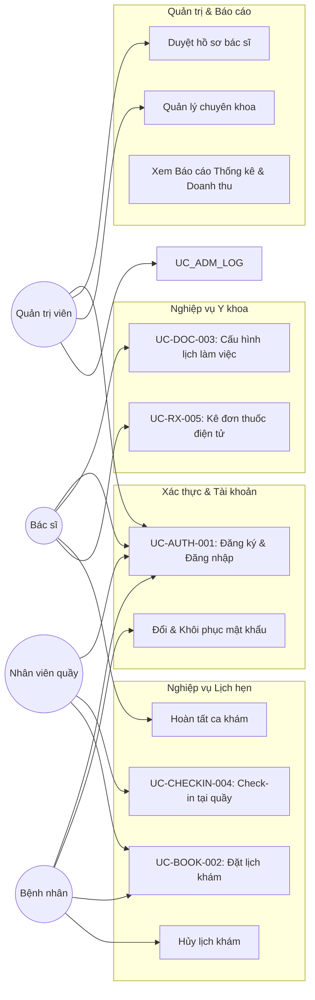
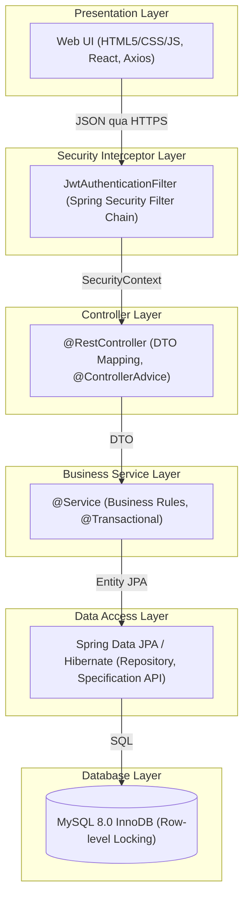
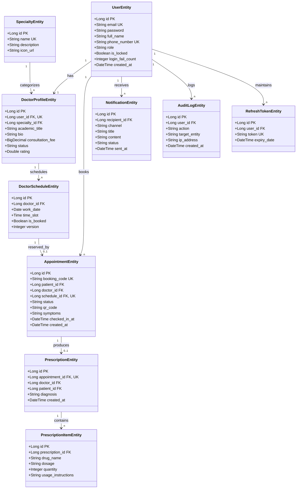

# TÀI LIỆU ĐẶC TẢ YÊU CẦU PHẦN MỀM (SRS) VÀ THIẾT KẾ HỆ THỐNG (SDS)

> **Dự án:** MEDSCHED PRO — Hệ thống đặt lịch chăm sóc sức khỏe & khám bệnh trực tuyến  
> **Mã tài liệu:** `SDLC-SRS-MSPRO-2026-V2.0`  
> **Áp dụng chuẩn:** IEEE Std 830-1998 / ISO/IEC/IEEE 29148:2018; quy trình Scrum (Scrum Guide)  
> **Phiên bản hiện hành:** 2.0 (Hiệu chỉnh theo Khung chương trình thực tập Agile/Scrum)  
> **Phạm vi triển khai:** Chương trình đào tạo thực tập sinh Java Web Fullstack (26 buổi / 6 Sprint)  
> **Đơn vị phát hành:** Ban Quy chuẩn Đồ án & Thực tập Doanh nghiệp  
> **Đối tượng sử dụng:** Thực tập sinh Developer, Thực tập sinh Tester, Mentor/Scrum Master, Hội đồng nghiệm thu  

---

## Thuộc tính tài liệu

| Thuộc tính tài liệu | Giá trị |
| --- | --- |
| **Mã tài liệu** | `SDLC-SRS-MSPRO-2026-V2.0` |
| **Phiên bản hiện hành** | 2.0 (Hiệu chỉnh theo Khung chương trình thực tập Agile/Scrum) |
| **Quy chuẩn áp dụng** | IEEE Std 830-1998; ISO/IEC/IEEE 29148:2018; quy trình Scrum (Scrum Guide) |
| **Phạm vi triển khai** | Chương trình đào tạo thực tập sinh Java Web Fullstack (26 buổi / 6 Sprint) |
| **Đơn vị phát hành** | Ban Quy chuẩn Đồ án & Thực tập Doanh nghiệp |
| **Đối tượng sử dụng** | Thực tập sinh Developer, Thực tập sinh Tester, Mentor/Scrum Master, Hội đồng nghiệm thu |

### Lịch sử cập nhật tài liệu (Change Log)

| Phiên bản | Ngày | Nội dung thay đổi chính | Người soạn |
| --- | --- | --- | --- |
| 1.0 | — | Bản đặc tả SRS & thiết kế kỹ thuật gốc (IEEE 830), 1 use case chi tiết, 3 bảng dữ liệu. | Ban Quy chuẩn |
| 2.0 | Hiện tại | Cấu trúc lại toàn bộ tài liệu theo ISO/IEC/IEEE 29148; bổ sung Product Backlog & ánh xạ Sprint theo khung chương trình thực tập; bổ sung đầy đủ Yêu cầu phi chức năng (NFR); bổ sung đặc tả API RESTful; mở rộng 5 Use Case chi tiết; mở rộng mô hình CSDL lên 10 bảng; bổ sung Ma trận truy vết yêu cầu (RTM); bổ sung Định nghĩa Hoàn tất (DoD)/Sẵn sàng (DoR); bổ sung Quản trị rủi ro. | Claude (theo yêu cầu hiệu chỉnh) |

---

# CHƯƠNG 1: GIỚI THIỆU TỔNG QUAN (INTRODUCTION)

## 1.1. Mục đích tài liệu
Tài liệu này đặc tả đầy đủ yêu cầu phần mềm (Software Requirements) và thiết kế hệ thống (Software Design) của dự án **MedSched Pro**, đồng thời đóng vai trò là tài liệu nền (baseline) để thực tập sinh Developer và Tester triển khai dự án theo đúng quy trình phát triển phần mềm SDLC kết hợp mô hình Agile/Scrum, bám sát Khung chương trình thực tập Java Web Fullstack (26 buổi học, 6 Sprint/giai đoạn).

Khác với bản đặc tả mô tả nghiệp vụ thông thường, tài liệu V2.0 bổ sung:
1. **Product Backlog và ánh xạ trực tiếp** từng yêu cầu vào Sprint cụ thể của khung chương trình;
2. **Yêu cầu phi chức năng định lượng được**;
3. **Đặc tả API hợp đồng (contract-first)** giữa Backend và Frontend;
4. **Ma trận truy vết yêu cầu (Requirement Traceability Matrix - RTM)** phục vụ kiểm thử và nghiệm thu.

## 1.2. Phạm vi sản phẩm (Product Scope)
Hệ thống **MedSched Pro** là một ứng dụng Web Fullstack (Java Spring Boot ở Backend, HTML/CSS/JavaScript hoặc Bootstrap/Tailwind ở Frontend) vận hành trên mô hình client-server, hỗ trợ giao diện đáp ứng (Responsive) cho hai nhóm thiết bị: máy tính để bàn (dành cho nhân viên y tế/quản trị) và thiết bị di động (dành cho bệnh nhân). Hệ thống giải quyết bài toán phân phối lịch hẹn khám bệnh theo thời gian thực, quản lý hồ sơ chuyên môn bác sĩ, quản lý vòng đời ca khám, và cung cấp các tiện ích vận hành phòng khám (check-in, kê đơn thuốc điện tử, báo cáo).

Phạm vi không bao gồm: thanh toán trực tuyến qua cổng thanh toán thật (Momo/VNPay), tích hợp Telemedicine (gọi video), và hệ thống Bảo hiểm y tế liên thông — các phần này được liệt kê ở mục 1.7 (Out-of-Scope) và có thể là đề tài mở rộng (stretch goal) cho nhóm thực tập sinh khá/giỏi.

## 1.3. Đối tượng sử dụng tài liệu

| Đối tượng | Cách sử dụng tài liệu |
| --- | --- |
| **Thực tập sinh Developer** | Đọc Chương 5 (Yêu cầu chức năng), Chương 6 (Use Case), Chương 8 (Kiến trúc), Chương 9 (UI/UX Wireframe), Chương 10 (API), Chương 11 (CSDL) để hiện thực hóa mã nguồn theo đúng Sprint được phân công. |
| **Thực tập sinh Tester** | Đọc Chương 5, 6, 7 (NFR) để thiết kế Test Case; dùng Chương 12 (Ma trận truy vết) để đảm bảo độ phủ kiểm thử. |
| **Mentor / Scrum Master** | Dùng Chương 4 (Backlog & Sprint Roadmap) để điều phối Sprint Planning/Review; dùng Chương 14 để chấm điểm nghiệm thu. |
| **Hội đồng nghiệm thu (Demo Day)** | Dùng Chương 14 (Tiêu chí nghiệm thu) và Chương 4.3 (Definition of Done) để đánh giá sản phẩm cuối kỳ. |

## 1.4. Thuật ngữ và từ viết tắt (Definitions & Acronyms)

| Thuật ngữ | Diễn giải |
| --- | --- |
| **SRS** | Software Requirement Specification - Tài liệu đặc tả yêu cầu phần mềm. |
| **SDS** | Software Design Specification - Tài liệu thiết kế chi tiết hệ thống. |
| **SDLC** | Software Development Life Cycle - Vòng đời phát triển phần mềm. |
| **Scrum/Sprint** | Khung làm việc Agile; Sprint là một chu kỳ phát triển ngắn (ở đây ứng với 1 giai đoạn G trong khung chương trình). |
| **DoR / DoD** | Definition of Ready / Definition of Done - Tiêu chí một hạng mục được phép bắt đầu / được xem là hoàn tất. |
| **RBAC** | Role-Based Access Control - Kiểm soát truy cập dựa trên vai trò. |
| **JWT** | JSON Web Token - Chuỗi mã hóa phi trạng thái phục vụ xác thực người dùng. |
| **JPA / ORM** | Java Persistence API - Giao diện lập trình lưu trữ thực thể Java xuống CSDL quan hệ. |
| **DTO** | Data Transfer Object - Đối tượng trung gian truyền dữ liệu giữa các tầng/API. |
| **MoSCoW** | Kỹ thuật ưu tiên yêu cầu: Must have, Should have, Could have, Won't have. |
| **RTM** | Requirement Traceability Matrix - Ma trận truy vết yêu cầu. |
| **NFR** | Non-Functional Requirement - Yêu cầu phi chức năng. |

## 1.5. Tài liệu tham khảo
- **IEEE Std 830-1998** — Recommended Practice for Software Requirements Specifications.
- **ISO/IEC/IEEE 29148:2018** — Systems and software engineering — Life cycle processes — Requirements engineering.
- **Scrum Guide (scrumguides.org)** — Khung lý thuyết Scrum (Sprint, Roles, Events, Artifacts).
- **Khung Chương trình Thực tập Java Web Fullstack** (`Khung_Chuong_Trinh_Thuc_Tap_Java_Fullstack.xlsx`) — Căn cứ phân bổ Sprint/buổi học áp dụng cho dự án này.

## 1.6. Quy trình phát triển áp dụng — Ánh xạ SDLC vào khung chương trình thực tập
Dự án áp dụng mô hình Agile/Scrum với các Sprint có thời lượng cố định, trùng khớp với cấu trúc 6 giai đoạn (G1–G6) của khung chương trình thực tập. Việc ánh xạ này được trình bày chi tiết tại Chương 4 (Product Backlog & Sprint Roadmap). Tóm tắt nhanh:

| Giai đoạn chương trình | Tương đương Sprint Scrum | Tuần / Buổi | Đầu ra kỳ vọng |
| --- | --- | --- | --- |
| **G1: Khởi tạo & Phân tích yêu cầu** | Sprint 0 (Discovery & Inception) | Tuần 1, Buổi 1-3 | Product Backlog, Git Flow, Definition of Done được thống nhất |
| **G2: Thiết kế hệ thống & CSDL** | Sprint 1 (Foundation & Database) | Tuần 2, Buổi 4-8 | ERD, DDL Script, Wireframe UI/UX, Thiết kế Kiến trúc |
| **G3: Phát triển Backend Core** | Sprint 2 (Core APIs & Security) | Tuần 3, Buổi 9-14 | RESTful APIs (Auth, Doctor, Booking), JWT Security, Unit Test |
| **G4: Tích hợp Frontend & Nâng cao** | Sprint 3 (Frontend Integration & Features) | Tuần 4, Buổi 15-19 | Giao diện Web Client & Admin, Tích hợp API, Search, Notification |
| **G5: Kiểm thử toàn diện & Tối ưu** | Sprint 4 (Testing & Optimization) | Tuần 5, Buổi 20-23 | Test Case Coverage ≥ 60%, Concurrency Test (JMeter), Fix Bugs |
| **G6: Triển khai & Nghiệm thu** | Sprint Release (Deployment & Demo) | Tuần 6, Buổi 24-26 | Dockerize, Deploy Cloud, Slide & Báo cáo đồ án, Demo Day |

## 1.7. Phạm vi loại trừ (Out of Scope) — Đề xuất mở rộng (Stretch Goals)
- Thanh toán trực tuyến qua cổng thanh toán thật (Momo, VNPay, Stripe) — có thể mock bằng trạng thái UNPAID/PAID hoặc tích hợp VietQR / Open Banking mở rộng.
- Gọi video / Telemedicine.
- Tích hợp liên thông Bảo hiểm Y tế (BHYT).
- CI/CD tự động qua GitHub Actions, viết Integration Test với Testcontainers — khuyến khích cho nhóm khá/giỏi.

---

# CHƯƠNG 2: MÔ TẢ TỔNG QUAN HỆ THỐNG (OVERALL DESCRIPTION)

## 2.1. Bối cảnh sản phẩm (Product Perspective)
**MedSched Pro** là sản phẩm độc lập (standalone), không phụ thuộc hệ thống doanh nghiệp khác, được xây dựng hoàn toàn mới (greenfield) bởi nhóm thực tập sinh. Hệ thống gồm 3 thành phần triển khai chính:
1. **Backend RESTful API** (Spring Boot 3.x);
2. **Frontend Web** (HTML/CSS/JS thuần hoặc Bootstrap/Tailwind CSS / React SPA);
3. **Cơ sở dữ liệu quan hệ** (MySQL 8.0 InnoDB).

Toàn bộ 3 thành phần được container hóa bằng Docker và triển khai lên nền tảng Cloud (Render/Railway/Supabase) ở Sprint Release.

## 2.2. Đối tượng người dùng & đặc điểm sử dụng

| Nhóm người dùng | Đặc điểm | Thiết bị chính |
| --- | --- | --- |
| **Bệnh nhân (Patient)** | Người dùng cuối phổ thông, ưu tiên thao tác nhanh, ít bước, ngôn ngữ thân thiện. | Mobile, tỷ lệ truy cập cao nhất |
| **Bác sĩ (Doctor)** | Nhân viên chuyên môn, cần xem lịch khám, quản lý ca khám, kê đơn thuốc nhanh chóng. | Desktop / Tablet |
| **Nhân viên tiếp đón (Staff/Receptionist)** | Thao tác check-in tại quầy, tra cứu lịch hẹn, tiếp nhận bệnh nhân theo luồng thực tế. | Desktop tại quầy khám |
| **Quản trị viên (Admin)** | Quản lý danh mục, phê duyệt hồ sơ bác sĩ, xem báo cáo thống kê tổng quan. | Desktop màn hình lớn |

## 2.3. Ràng buộc thiết kế & công nghệ (Design & Implementation Constraints)
Theo Khung chương trình thực tập, nhóm Developer BẮT BUỘC sử dụng bộ công nghệ sau (không tự ý thay thế khi chưa có sự đồng ý của Mentor):

| Lớp/Hạng mục | Công nghệ bắt buộc |
| --- | --- |
| **Backend Framework** | Java 17+, Spring Boot 3.x (Spring Web, Spring Data JPA, Spring Security, Spring Validation) |
| **Build tool** | Maven hoặc Gradle |
| **Cơ sở dữ liệu** | MySQL 8.0 (InnoDB Storage Engine) |
| **Xác thực/Phân quyền** | JWT (JSON Web Token) + Spring Security Filter Chain, BCryptPasswordEncoder |
| **Frontend** | HTML5/CSS3/JavaScript thuần, hoặc Bootstrap/Tailwind CSS; gọi API qua Fetch API/Axios |
| **Quản lý mã nguồn** | Git/GitHub theo mô hình Git Flow (nhánh `main` / `develop` / `feature/*`) |
| **Quản lý công việc Agile** | Jira hoặc Trello (Backlog, Sprint Board, Burndown) |
| **Kiểm thử** | JUnit 5 + Mockito (Unit Test); Postman/Postman Collection (API Test); Apache JMeter (Concurrency Test) |
| **Đóng gói & Triển khai** | Docker (Dockerfile + docker-compose), triển khai Cloud miễn phí (Render/Railway/Supabase) |
| **Công cụ AI hỗ trợ** | ChatGPT/GitHub Copilot/Claude — chỉ hỗ trợ sinh mã, KHÔNG thay thế việc hiểu logic; sinh viên phải giải trình được mọi đoạn mã do AI sinh ra khi phản biện. |

## 2.4. Giả định và phụ thuộc (Assumptions & Dependencies)
- Mỗi nhóm thực tập có tối thiểu 1 thành viên đóng vai trò Scrum Master kiêm Developer/Tester.
- Hạ tầng Cloud miễn phí (Render/Railway) có thể có giới hạn tài nguyên (RAM, sleep sau thời gian không dùng) — nhóm cần thiết kế ứng dụng nhẹ, tránh memory leak.
- Dữ liệu mẫu (seed data) cho bác sĩ, chuyên khoa được Mentor cung cấp hoặc nhóm tự tạo bằng script SQL ở Sprint 0.
- Backend và Frontend phát triển song song từ Sprint 2 dựa trên hợp đồng API (API Contract) đã thống nhất tại Chương 10 — nếu API thay đổi phải cập nhật tài liệu và thông báo nhóm Frontend qua Jira.

---

# CHƯƠNG 3: TÁC NHÂN HỆ THỐNG (ACTORS)

| Tác nhân | Mã quyền | Vai trò nghiệp vụ chính |
| --- | --- | --- |
| **Quản trị viên (Admin)** | `ROLE_ADMIN` | Toàn quyền hệ thống: duyệt hồ sơ bác sĩ, quản lý danh mục chuyên khoa, khóa/mở tài khoản, xem báo cáo tổng hợp và thống kê doanh thu. |
| **Bác sĩ (Doctor)** | `ROLE_DOCTOR` | Đăng ký hồ sơ chuyên môn, cấu hình lịch làm việc (khung giờ khám), xem danh sách bệnh nhân hẹn khám, kê đơn thuốc điện tử. |
| **Bệnh nhân (Patient)** | `ROLE_PATIENT` | Đăng ký/đăng nhập, tìm kiếm bác sĩ theo chuyên khoa, đặt lịch khám, nhận mã QR lịch hẹn, xem lịch sử khám và đơn thuốc. |
| **Nhân viên tiếp đón (Staff)** | `ROLE_STAFF` | Quét mã QR check-in bệnh nhân tại quầy, tra cứu lịch hẹn, hỗ trợ đặt lịch cho bệnh nhân vãng lai. |
| **Hệ thống / Tác nhân kỹ thuật** | `SYSTEM` | Cron Job nhắc lịch hẹn, hàng đợi gửi email bất đồng bộ, dịch vụ lưu trữ file (Cloudinary/S3). |

---

# CHƯƠNG 4: PRODUCT BACKLOG VÀ LỘ TRÌNH SPRINT (BACKLOG & SPRINT ROADMAP)

## 4.1. Nguyên tắc ánh xạ
Mỗi yêu cầu chức năng ở Chương 5 được gắn một mã Sprint (Sprint 0/1/2/3/Release) tương ứng với giai đoạn G1-G6 của khung chương trình thực tập. Nhóm KHÔNG bắt buộc phải hoàn thành 100% backlog của một Sprint mới được sang Sprint kế tiếp, nhưng các hạng mục gắn nhãn 'Must have' của Sprint trước là điều kiện đầu vào (input) bắt buộc cho Sprint sau.

## 4.2. Bảng Sprint Roadmap (chi tiết theo buổi học)

| Sprint | Buổi (theo khung CT) | Sự kiện Scrum cần tổ chức | Output bắt buộc cuối Sprint |
| --- | --- | --- | --- |
| **Sprint 0 – Discovery & Design** | Buổi 1-5 (Tuần 1) | Sprint Planning 0 (Buổi 1), Backlog Refinement (Buổi 2-3), Design Review (Buổi 4-5) | Product Backlog đầy đủ User Story + Acceptance Criteria trên Jira; ERD được Mentor phê duyệt; Script SQL khởi tạo CSDL chạy không lỗi; Git repo + Git Flow + README + DoD được thống nhất. |
| **Sprint 1 – Core Architecture & Security** | Buổi 6-11 (Tuần 2-3) | Sprint Planning 1, Daily Standup, Sprint Review 1 | Hoàn thành EPIC-AUTH (Đăng ký/Đăng nhập JWT, Phân quyền RBAC), EPIC-DOC (CRUD chuyên khoa, Bác sĩ, Khung giờ khám), Khởi tạo khung dự án Spring Boot + Unit Test cơ bản. |
| **Sprint 2 – Booking Engine & Frontend UI** | Buổi 12-16 (Tuần 3-4) | Sprint Planning 2, Daily Standup, Sprint Review 2 | Hoàn thành EPIC-BOOKING (Đặt lịch, Optimistic Locking chống Double Booking, State Machine vòng đời ca khám), Dựng UI Responsive theo Wireframe, Tích hợp API Client. |
| **Sprint 3 – Advanced Features & Testing** | Buổi 17-21 (Tuần 4-5) | Sprint Planning 3, Backlog Grooming, Sprint Review 3 | Hoàn thành EPIC-SEARCH (Tìm kiếm nâng cao/Phân trang), EPIC-RX (Đơn thuốc điện tử), EPIC-NOTIFY (Email bất đồng bộ), Check-in mã QR, Bộ Test Case đạt Coverage ≥ 60%. |
| **Sprint Release – Deployment & Demo** | Buổi 22-26 (Tuần 6) | Sprint Retrospective, Pre-demo Review, Demo Day | Đóng gói Docker, Triển khai Cloud (Render/Railway), Chạy ổn định ≥ 48h, Hoàn thiện Slide, Báo cáo đồ án, Demo sản phẩm thực tế trước Hội đồng. |

## 4.3. Định nghĩa Sẵn sàng & Hoàn tất (Definition of Ready / Done)

### Definition of Ready (DoR) — Một User Story được phép đưa vào Sprint khi:
- Có mô tả theo cú pháp: `'Là [vai trò], tôi muốn [hành động] để [giá trị/lợi ích]'`.
- Có Tiêu chí chấp nhận (Acceptance Criteria) viết theo cấu trúc `Given-When-Then`, đã được Mentor/Product Owner xác nhận.
- Đã ước lượng được công sức (Story Point) và không phụ thuộc hạng mục chưa hoàn thành ở Sprint trước.

### Definition of Done (DoD) — Một hạng mục được xem là hoàn tất khi:
- Mã nguồn được merge vào nhánh `develop` qua Pull Request có ít nhất 1 review, không còn lỗi biên dịch/cảnh báo nghiêm trọng.
- API liên quan có Unit Test (tầng Service) và đã kiểm thử thủ công bằng Postman, trả đúng mã HTTP theo đặc tả Chương 10.
- Giao diện (nếu có) hiển thị đúng trên tối thiểu 2 kích thước màn hình (Desktop, Mobile) và xử lý được trạng thái lỗi/rỗng dữ liệu.
- Tài liệu (API doc/Jira ticket) được cập nhật trạng thái Done kèm minh chứng (ảnh chụp, link demo).

---

# CHƯƠNG 5: YÊU CẦU CHỨC NĂNG CHI TIẾT (FUNCTIONAL REQUIREMENTS)

Mỗi yêu cầu được trình bày theo định dạng: **Mã YC | User Story | Tiêu chí chấp nhận chính | Độ ưu tiên (MoSCoW: M=Must, S=Should, C=Could) | Sprint áp dụng**. Toàn bộ mã yêu cầu được truy vết tại Ma trận Chương 12.

## 5.1. EPIC-AUTH — Xác thực & Quản lý tài khoản

| Mã YC | User Story (Là...tôi muốn...để...) | Tiêu chí chấp nhận chính | Ưu tiên | Sprint |
| --- | --- | --- | --- | --- |
| **REQ-AUTH-01** | Là Bệnh nhân, tôi muốn đăng ký tài khoản bằng email/SĐT/mật khẩu để sử dụng hệ thống. | Email & SĐT không trùng; mật khẩu được băm BCrypt; trả 201 kèm thông tin user (không trả password). | **M** | Sprint 1 |
| **REQ-AUTH-02** | Là người dùng, tôi muốn đăng nhập để nhận JWT truy cập các API được phân quyền. | Sai thông tin 5 lần liên tiếp → khóa tài khoản (`is_locked=true`), trả 423 Locked; đúng thông tin trả 200 kèm access token. | **M** | Sprint 1 |
| **REQ-AUTH-03** | Là hệ thống, tôi cần phân quyền RBAC để mỗi API chỉ được gọi bởi đúng vai trò. | Method-level `@PreAuthorize` hoặc `SecurityFilterChain` chặn đúng theo role; gọi sai quyền trả 403 Forbidden. | **M** | Sprint 1 |
| **REQ-AUTH-04** | Là người dùng, tôi muốn đổi mật khẩu khi đã đăng nhập. | Yêu cầu xác nhận mật khẩu cũ đúng trước khi đổi; mật khẩu mới tối thiểu 8 ký tự. | **S** | Sprint 2 |
| **REQ-AUTH-05** | Là Bệnh nhân, tôi muốn khôi phục mật khẩu qua email khi quên. | Gửi OTP/Token có hiệu lực 15 phút qua email; sau khi dùng token sẽ vô hiệu hóa ngay. | **S** | Sprint 2 |

## 5.2. EPIC-DOCTOR — Quản lý Bác sĩ & Chuyên khoa

| Mã YC | User Story (Là...tôi muốn...để...) | Tiêu chí chấp nhận chính | Ưu tiên | Sprint |
| --- | --- | --- | --- | --- |
| **REQ-DOC-01** | Là Admin, tôi muốn tạo và quản lý danh mục chuyên khoa để phân loại bác sĩ. | Tên chuyên khoa không được trùng lặp; chỉ cho phép xóa chuyên khoa khi chưa có bác sĩ nào liên kết. | **M** | Sprint 1 |
| **REQ-DOC-02** | Là Bác sĩ, tôi muốn cập nhật hồ sơ chuyên môn (tiểu sử, học hàm, giá khám). | Hồ sơ sau khi cập nhật chuyển sang trạng thái chờ duyệt nếu có thay đổi thông tin quan trọng. | **M** | Sprint 1 |
| **REQ-DOC-03** | Là Bác sĩ, tôi muốn tạo khung giờ làm việc theo ngày để bệnh nhân đặt lịch. | Sinh time-slot cách nhau 30 phút; ràng buộc UNIQUE (`doctor_id, work_date, time_slot`) chống trùng giờ. | **M** | Sprint 1 |
| **REQ-DOC-04** | Là Bệnh nhân, tôi muốn xem danh sách bác sĩ kèm chuyên khoa và giá khám. | Hiển thị đầy đủ thông tin tóm tắt: họ tên, học vị, chuyên khoa, phòng khám, giá khám, rating. | **M** | Sprint 1 |

## 5.3. EPIC-BOOKING — Đặt lịch & Vòng đời ca khám

| Mã YC | User Story (Là...tôi muốn...để...) | Tiêu chí chấp nhận chính | Ưu tiên | Sprint |
| --- | --- | --- | --- | --- |
| **REQ-BOOK-01** | Là Bệnh nhân, tôi muốn đặt lịch khám vào khung giờ còn trống của bác sĩ. | Kiểm tra slot còn trống; khóa lạc quan tránh trùng lịch; tạo lịch hẹn trạng thái `PENDING`, trả mã QR. | **M** | Sprint 2 |
| **REQ-BOOK-02** | Là Bệnh nhân, tôi muốn xem danh sách lịch hẹn của bản thân kèm trạng thái. | Hiển thị danh sách nhóm theo trạng thái (Chờ xác nhận, Đã xác nhận, Đã khám, Đã hủy). | **M** | Sprint 2 |
| **REQ-BOOK-03** | Là Bệnh nhân, tôi muốn hủy lịch hẹn trước giờ khám tối thiểu 2 giờ. | Chỉ cho phép hủy khi lịch ở trạng thái `PENDING` hoặc `CONFIRMED`; cập nhật slot về trống; đổi trạng thái `CANCELLED`. | **S** | Sprint 2 |
| **REQ-BOOK-04** | Là Nhân viên quầy, tôi muốn quét mã QR để check-in bệnh nhân đến phòng khám. | Quét mã QR giải mã đúng mã lịch hẹn; kiểm tra đúng ngày hẹn; chuyển trạng thái `CHECKED_IN`. | **M** | Sprint 2 |
| **REQ-BOOK-05** | Là Bác sĩ, tôi muốn hoàn tất ca khám sau khi đã thăm khám cho bệnh nhân. | Chuyển trạng thái lịch hẹn từ `CHECKED_IN` sang `COMPLETED`; kích hoạt luồng cho phép kê đơn thuốc. | **M** | Sprint 2 |
| **REQ-BOOK-06** | Là hệ thống, tôi cần một State Machine để chặn chuyển trạng thái phi logic. | Chỉ cho phép các cạnh hợp lệ: `PENDING → CONFIRMED → COMPLETED`; `PENDING/CONFIRMED → CANCELLED`; mọi chuyển đổi khác trả 400 Bad Request. | **M** | Sprint 1/2 |

## 5.4. EPIC-SEARCH — Tìm kiếm & Phân trang nâng cao

| Mã YC | User Story (Là...tôi muốn...để...) | Tiêu chí chấp nhận chính | Ưu tiên | Sprint |
| --- | --- | --- | --- | --- |
| **REQ-SEARCH-01** | Là Bệnh nhân, tôi muốn tìm kiếm bác sĩ theo từ khóa tên, chuyên khoa, ngày trống. | Hỗ trợ tìm kiếm kết hợp nhiều điều kiện; phân trang chuẩn (`page`, `size`); chống SQL Injection qua Criteria API. | **M** | Sprint 3 |
| **REQ-SEARCH-02** | Là Bệnh nhân, tôi muốn lọc bác sĩ theo mức giá khám và sắp xếp theo đánh giá. | Lọc theo khoảng giá `[min_price, max_price]`; sắp xếp tăng/giảm dần theo rating hoặc giá khám. | **S** | Sprint 3 |

## 5.5. EPIC-FILE — Tải tệp tin lên Cloud

| Mã YC | User Story (Là...tôi muốn...để...) | Tiêu chí chấp nhận chính | Ưu tiên | Sprint |
| --- | --- | --- | --- | --- |
| **REQ-FILE-01** | Là Bác sĩ / Admin, tôi muốn tải ảnh đại diện lên Cloud để lưu trữ. | Kiểm tra định dạng ảnh (JPG/PNG/WEBP), kích thước tối đa 5MB; lưu lên Cloudinary hoặc S3; trả URL CDN. | **S** | Sprint 3 |

## 5.6. EPIC-NOTIFY — Thông báo đa kênh

| Mã YC | User Story (Là...tôi muốn...để...) | Tiêu chí chấp nhận chính | Ưu tiên | Sprint |
| --- | --- | --- | --- | --- |
| **REQ-NOTI-01** | Là Bệnh nhân, tôi muốn nhận email xác nhận kèm mã QR ngay sau khi đặt lịch thành công. | Gửi email bất đồng bộ qua `@Async` hoặc Queue; không làm chậm luồng phản hồi API; nội dung gồm chi tiết lịch hẹn và QR. | **M** | Sprint 3 |
| **REQ-NOTI-02** | Là hệ thống, tôi cần tự động gửi email nhắc lịch trước giờ khám 24 giờ. | Cron job chạy định kỳ quét các lịch hẹn sắp diễn ra trong ngày kế tiếp để gửi email nhắc nhở. | **S** | Sprint 3 |

## 5.7. EPIC-RX — Đơn thuốc điện tử

| Mã YC | User Story (Là...tôi muốn...để...) | Tiêu chí chấp nhận chính | Ưu tiên | Sprint |
| --- | --- | --- | --- | --- |
| **REQ-RX-01** | Là Bác sĩ, tôi muốn kê đơn thuốc cho bệnh nhân sau khi ca khám hoàn tất. | Chỉ kê đơn khi lịch hẹn đã `COMPLETED`; đơn thuốc gồm danh sách chi tiết: tên thuốc, hàm lượng, số lượng, cách dùng. | **M** | Sprint 3 |
| **REQ-RX-02** | Là Bệnh nhân, tôi muốn xem lại chi tiết đơn thuốc điện tử trong hồ sơ ca khám. | Hiển thị đơn thuốc chính xác của ca khám; cho phép tải về định dạng PDF hoặc xem trực tiếp trên ứng dụng. | **M** | Sprint 3 |

## 5.8. EPIC-ADMIN — Quản trị & Báo cáo

| Mã YC | User Story (Là...tôi muốn...để...) | Tiêu chí chấp nhận chính | Ưu tiên | Sprint |
| --- | --- | --- | --- | --- |
| **REQ-ADM-01** | Là Admin, tôi muốn phê duyệt hoặc từ chối hồ sơ đăng ký bác sĩ mới. | Chỉ bác sĩ có trạng thái `APPROVED` mới được hiển thị trên trang tìm kiếm và được tạo lịch làm việc. | **M** | Sprint 3 |
| **REQ-ADM-02** | Là Admin, tôi muốn xem thống kê tổng quan (số lượt khám, doanh thu ước tính, tỷ lệ hủy). | Dashboard trực quan với các thẻ KPI và biểu đồ thống kê theo tuần / tháng. | **S** | Sprint 3 |

## 5.9. EPIC-TEST — Chất lượng & Kiểm thử

| Mã YC | User Story (Là...tôi muốn...để...) | Tiêu chí chấp nhận chính | Ưu tiên | Sprint |
| --- | --- | --- | --- | --- |
| **REQ-TEST-01** | Là Đội ngũ phát triển, hệ thống phải có bộ kiểm thử tự động tầng Service. | Độ bao phủ mã nguồn (Unit Test Coverage) đạt tối thiểu ≥ 60% tổng số dòng mã tầng Service. | **M** | Sprint 3 |
| **REQ-TEST-02** | Là Tester, tôi cần kiểm thử tải đồng thời chức năng đặt lịch bằng JMeter. | Mô phỏng 20+ luồng cùng đặt 1 slot, chứng minh hệ thống không bị Double Booking. | **M** | Sprint 3 |

## 5.10. EPIC-OPS — DevOps & Triển khai

| Mã YC | User Story (Là...tôi muốn...để...) | Tiêu chí chấp nhận chính | Ưu tiên | Sprint |
| --- | --- | --- | --- | --- |
| **REQ-OPS-01** | Là Đội ngũ phát triển, hệ thống phải được đóng gói bằng Docker và Docker Compose. | Có tệp `Dockerfile` và `docker-compose.yml` khởi chạy trọn gói Backend + Database bằng 1 câu lệnh. | **M** | Release |
| **REQ-OPS-02** | Là Đội ngũ phát triển, hệ thống phải được deploy lên môi trường Cloud công khai. | Ứng dụng chạy online ổn định trên Cloud (Render/Railway/Vercel) có URL truy cập công khai phục vụ Demo. | **M** | Release |

---

# CHƯƠNG 6: ĐẶC TẢ USE CASE CHI TIẾT (DETAILED USE CASE SPECIFICATION)

Định dạng đặc tả tuân thủ chuẩn Use Case Template (Cockburn rút gọn): Mã, Tác nhân, Tiền điều kiện, Hậu điều kiện, Luồng chính, Luồng thay thế, Luồng ngoại lệ.

## 6.0. Sơ đồ Use Case tổng quan (UML Use Case Diagram)
Hình 6.1 thể hiện quan hệ giữa 4 nhóm tác nhân (`Patient`, `Doctor`, `Staff`, `Admin`) với các Use Case chính của hệ thống MedSched Pro.



---

## UC-AUTH-001: Đăng ký & Đăng nhập tài khoản
- **Tác nhân chính:** Patient, Doctor, Staff (tài khoản Doctor/Staff/Admin do Admin cấp trước).
- **Tiền điều kiện:** Người dùng chưa có tài khoản (luồng đăng ký) hoặc đã có tài khoản hợp lệ, chưa bị khóa (luồng đăng nhập).
- **Hậu điều kiện:** Tài khoản mới được lưu với vai trò mặc định `ROLE_PATIENT`; hoặc Client nhận được Access Token JWT hợp lệ.
- **Luồng xử lý chính (Đăng ký):**
  1. Người dùng nhập email, mật khẩu, họ tên, số điện thoại.
  2. Hệ thống kiểm tra định dạng email/SĐT, kiểm tra tính duy nhất trong CSDL.
  3. Hệ thống băm mật khẩu bằng BCrypt, lưu bản ghi người dùng với `role=ROLE_PATIENT`, `is_locked=false`.
  4. Trả về mã HTTP `201 Created` kèm thông tin người dùng (không trả mật khẩu).
- **Luồng xử lý chính (Đăng nhập):**
  1. Người dùng gửi thông tin email và mật khẩu lên hệ thống.
  2. Hệ thống xác thực thông tin qua `AuthenticationManager`.
  3. Nếu thông tin chính xác, hệ thống sinh chuỗi JWT (chứa email, role, thời hạn) và trả về mã HTTP `200 OK`.
  4. Nếu thông tin không chính xác, tăng biến đếm `login_fail_count`; nếu vượt ngưỡng 5 lần liên tiếp, cập nhật `is_locked=true`.
- **Luồng ngoại lệ:**
  - Email đã tồn tại trong hệ thống → Trả về `409 Conflict`.
  - Tài khoản đang bị khóa (`is_locked=true`) → Trả về `423 Locked` kèm thông điệp hướng dẫn liên hệ Admin.
  - Sai định dạng dữ liệu đầu vào (Bean Validation) → Trả về `400 Bad Request` kèm chi tiết trường lỗi.

---

## UC-BOOK-002: Đặt lịch khám (Book Appointment)
- **Tác nhân chính:** Patient, Staff.
- **Tác nhân hỗ trợ:** Database System (kiểm soát tương tranh đồng thời).
- **Tiền điều kiện:** Người dùng đã đăng nhập; hồ sơ cá nhân đã có số điện thoại/CCCD; bác sĩ đã được duyệt hồ sơ và có time-slot trống.
- **Hậu điều kiện:** Một bản ghi `appointments` mới ở trạng thái `PENDING` được tạo; time-slot tương ứng được cập nhật `is_booked=true`.
- **Luồng xử lý chính:**
  1. Người dùng chọn Chuyên khoa và Bác sĩ mong muốn.
  2. Hệ thống trả danh sách ngày và khung giờ còn trống (`GET /api/doctors/{id}/schedules?date=...`).
  3. Người dùng chọn 1 khung giờ phù hợp, nhập triệu chứng sơ bộ và bấm xác nhận đặt lịch (`POST /api/appointments`).
  4. Hệ thống mở giao dịch `@Transactional`, kiểm tra version hiện tại của `DoctorSchedule` (Optimistic Locking).
  5. Hệ thống lưu bản ghi lịch hẹn ở trạng thái `PENDING`, cập nhật slot `is_booked=true`, tăng version, trả về `201 Created` kèm mã QR định danh lịch hẹn.
  6. Hệ thống kích hoạt sự kiện gửi email xác nhận bất đồng bộ (REQ-NOTI-01).
- **Luồng ngoại lệ:**
  - *(a) Trùng lịch (Overbooking):* Khung giờ vừa bị người khác đặt trước, Hibernate ném `ObjectOptimisticLockingFailureException`; Backend rollback giao dịch, trả về `409 Conflict` với thông báo: *"Khung giờ này vừa có người đặt. Vui lòng chọn khung giờ khác"*.
  - *(b) Hồ sơ chưa hoàn thiện:* Thiếu SĐT hoặc CCCD → Trả về `422 Unprocessable Entity`.
  - *(c) Khung giờ không hợp lệ:* Time-slot không tồn tại hoặc đã qua thời điểm hiện tại → Trả về `400 Bad Request`.

### Sơ đồ trình tự (UML Sequence Diagram) — Đặt lịch khám UC-BOOK-002


*Hình 6.2 — Sơ đồ trình tự (UML Sequence Diagram) luồng đặt lịch khám UC-BOOK-002, bao gồm nhánh thành công và nhánh xung đột khóa lạc quan (Optimistic Locking).*

```mermaid
sequenceDiagram
    autonumber
    actor Patient as Bệnh nhân (Patient)
    participant UI as Frontend (Web UI)
    participant Ctrl as AppointmentController
    participant Svc as BookingService
    participant DB as Database (MySQL)

    Patient->>UI: 1: Chọn time-slot & xác nhận đặt lịch
    UI->>Ctrl: 2: POST /api/appointments
    Ctrl->>Svc: 3: bookAppointment(dto)
    Svc->>DB: 4: SELECT schedule (đọc version=v)
    DB-->>Svc: 5: trả schedule (is_booked=false, version=v)
    
    alt Version khớp & slot còn trống (Thành công)
        Svc->>DB: 6: UPDATE schedule SET is_booked=true, version=v+1; INSERT appointment
        DB-->>Svc: 7: OK (1 row affected)
        Svc-->>Ctrl: 8: trả AppointmentDTO + mã QR
        Ctrl-->>UI: 9: 201 Created
        UI-->>Patient: 10: Hiển thị Đặt lịch thành công + QR
    else Xung đột phiên bản / slot vừa bị đặt trước (Trùng lịch)
        Svc->>DB: 6*: UPDATE ... (0 row / version mismatch)
        DB-->>Svc: ObjectOptimisticLockingFailureException
        Svc-->>Ctrl: 409 Conflict: 'Khung giờ vừa có người đặt'
        Ctrl-->>UI: Hiển thị lỗi, yêu cầu chọn slot khác
    end
```

---

## UC-DOC-003: Cấu hình lịch làm việc của Bác sĩ
- **Tác nhân chính:** Doctor.
- **Tiền điều kiện:** Bác sĩ đã được Admin duyệt hồ sơ (`status=APPROVED`).
- **Hậu điều kiện:** Danh sách time-slot mới được thêm vào `doctor_schedules`, sẵn sàng cho Patient đặt lịch.
- **Luồng xử lý chính:**
  1. Bác sĩ chọn ngày làm việc và khoảng thời gian áp dụng (ví dụ các slot 30 phút từ 08:00 - 17:00).
  2. Hệ thống tự động sinh các bản ghi time-slot tương ứng, mặc định `is_booked=false`.
  3. Hệ thống kiểm tra ràng buộc duy nhất `UNIQUE(doctor_id, work_date, time_slot)` để chống trùng lặp.
  4. Trả về mã HTTP `201 Created` kèm danh sách slot vừa tạo.
- **Luồng ngoại lệ:**
  - Tạo slot cho ngày trong quá khứ → Trả về `400 Bad Request`.
  - Slot đã tồn tại trong hệ thống → Bỏ qua bản ghi trùng, trả về danh sách slot tạo thành công kèm cảnh báo các slot bị trùng.

---

## UC-CHECKIN-004: Check-in bệnh nhân bằng mã QR tại quầy
- **Tác nhân chính:** Staff (Nhân viên tiếp đón).
- **Tiền điều kiện:** Lịch hẹn đang ở trạng thái `CONFIRMED` và đúng ngày hẹn khám.
- **Hậu điều kiện:** Lịch hẹn chuyển sang trạng thái `CHECKED_IN`, ghi nhận thời gian `checked_in_at`.
- **Luồng xử lý chính:**
  1. Nhân viên quét mã QR của bệnh nhân bằng máy quét hoặc camera thiết bị.
  2. Hệ thống giải mã và tra cứu lịch hẹn tương ứng trong cơ sở dữ liệu.
  3. Hệ thống kiểm tra điều kiện hợp lệ: trạng thái `CONFIRMED` và `appointment_date` trùng ngày hiện tại.
  4. Cập nhật trạng thái sang `CHECKED_IN`, ghi nhận thời gian check-in và hiển thị thông tin bệnh nhân lên màn hình quầy.
- **Luồng ngoại lệ:**
  - Mã QR không hợp lệ hoặc không tìm thấy lịch hẹn → Trả về `404 Not Found`.
  - Lịch hẹn sai ngày hoặc đã ở trạng thái `CANCELLED` / `COMPLETED` → Trả về `422 Unprocessable Entity` kèm lý do cụ thể.

---

## UC-RX-005: Kê đơn thuốc điện tử
- **Tác nhân chính:** Doctor.
- **Tiền điều kiện:** Lịch hẹn liên quan đã được bác sĩ hoàn tất và ở trạng thái `COMPLETED`.
- **Hậu điều kiện:** Một bản ghi `prescriptions` kèm danh sách các dòng thuốc `prescription_items` được tạo, liên kết với `appointment_id`.
- **Luồng xử lý chính:**
  1. Bác sĩ mở ca khám đã hoàn tất trong giao diện làm việc, chọn chức năng 'Kê đơn'.
  2. Bác sĩ thêm từng dòng thuốc (tên thuốc, hàm lượng, số lượng, hướng dẫn sử dụng).
  3. Hệ thống lưu đơn thuốc liên kết với `appointment_id` và `patient_id`, trả về `201 Created`.
  4. Bệnh nhân có thể xem lại chi tiết đơn thuốc trong lịch sử khám cá nhân (REQ-RX-02).
- **Luồng ngoại lệ:**
  - Kê đơn cho ca khám chưa hoàn tất (`status != COMPLETED`) → Trả về `409 Conflict`.
  - Đơn thuốc không có dòng thuốc nào → Trả về `400 Bad Request` (Bean Validation `@NotEmpty`).

---

# CHƯƠNG 7: YÊU CẦU PHI CHỨC NĂNG (NON-FUNCTIONAL REQUIREMENTS)

| Hạng mục | Yêu cầu định lượng / tiêu chí đo lường |
| --- | --- |
| **Hiệu năng (Performance)** | Thời gian phản hồi API trung bình < 500ms, P95 < 1000ms khi mô phỏng 200 người dùng đồng thời bằng Apache JMeter (đo ở MODULE-BOOK theo Chương 5.10 bảng phân việc Tester). |
| **Đồng thời (Concurrency)** | Không xảy ra hiện tượng Double Booking khi 2 request đặt cùng 1 time-slot trong cùng 1 giây (kiểm thử bằng JMeter Thread Group ≥ 20 luồng). |
| **Bảo mật (Security)** | Mật khẩu băm BCrypt (cost factor ≥ 10); JWT access token hết hạn ≤ 24h; toàn bộ endpoint nhạy cảm yêu cầu HTTPS khi deploy; chống SQL Injection bằng JPA/Prepared Statement (không nối chuỗi SQL thủ công); rà soát OWASP Top 10 cơ bản (Injection, Broken Auth, Sensitive Data Exposure). |
| **Khả dụng (Availability)** | Hệ thống deploy Cloud phải hoạt động ổn định liên tục tối thiểu 48 giờ trước Demo Day, không lỗi 500 ở các luồng chính. |
| **Khả năng mở rộng (Scalability)** | Backend không lưu trạng thái phiên ở Server (stateless JWT) để có thể scale-out theo chiều ngang; connection pool (HikariCP) cấu hình rõ kích thước tối đa. |
| **Khả dụng dùng (Usability)** | Giao diện đáp ứng (Responsive) tối thiểu 2 breakpoint (≥1024px và ≤480px); thông báo lỗi hiển thị rõ ràng bằng tiếng Việt, không hiển thị Stacktrace kỹ thuật cho người dùng cuối. |
| **Khả năng bảo trì (Maintainability)** | Mã nguồn phân tầng rõ Controller-Service-Repository theo package by-layer hoặc by-feature; không có mã trùng lặp (DRY); không hardcode URL/Credential (dùng application.yml + biến môi trường). |
| **Khả năng kiểm thử (Testability)** | Tầng Service phải có thể unit test độc lập (Dependency Injection qua interface); coverage tối thiểu theo Chương 14. |
| **Khả chuyển (Portability)** | Toàn bộ ứng dụng build & run được bằng Docker trên mọi máy có Docker Engine, không phụ thuộc cấu hình cứng của máy lập trình viên. |
| **Riêng tư & An toàn dữ liệu (Privacy)** | Không log thông tin định danh cá nhân (PII) nhạy cảm (mật khẩu, số CCCD) ra console/log file; áp dụng nguyên tắc bảo vệ dữ liệu cá nhân tương tự tinh thần HIPAA ở mức mô phỏng học thuật. |
| **Ghi log & Giám sát (Logging/Monitoring)** | Dùng SLF4J/Logback; mọi exception nghiệp vụ được log ở mức WARN/ERROR kèm context (không kèm dữ liệu nhạy cảm); khuyến nghị bật Spring Boot Actuator /health cho môi trường deploy. |

---

# CHƯƠNG 8: KIẾN TRÚC HỆ THỐNG (SYSTEM ARCHITECTURE)

## 8.1. Mô hình kiến trúc đa tầng (Layered Architecture)
Hệ thống MedSched Pro được thiết kế theo mô hình kiến trúc phân tầng chuẩn mực của các ứng dụng doanh nghiệp Spring Boot:


*Hình 8.1 — Sơ đồ thành phần (UML Component Diagram) thể hiện kiến trúc đa tầng của hệ thống MedSched Pro.*



## 8.2. Cơ chế bảo mật — JWT Authentication Filter
Mọi request gửi lên Backend phải đi qua bộ lọc bảo mật để trích xuất JWT từ header `Authorization: Bearer <token>`.  
Sơ đồ luồng xử lý:  
`Client → Filter trích token → Validate chữ ký & thời hạn → Nạp UserDetails → Gán vào SecurityContextHolder → FilterChain tiếp tục đến Controller`.  
Nếu token không hợp lệ hoặc hết hạn, request vẫn được chuyển tiếp nhưng không có Authentication, dẫn đến mã lỗi `401 Unauthorized` hoặc `403 Forbidden` ở tầng Controller khi endpoint yêu cầu quyền.

## 8.3. Cơ chế chống trùng lịch — Optimistic Locking
Với nghiệp vụ đặt lịch hẹn, hệ thống lựa chọn **Optimistic Locking** (annotation `@Version` trên `DoctorSchedule`) thay cho Pessimistic Locking (`SELECT ... FOR UPDATE`) để tránh nghẽn kết nối khi nhiều bệnh nhân truy cập đồng thời.  
Mỗi lần cập nhật `is_booked`, Hibernate tự so khớp giá trị version hiện tại với version đã đọc; nếu khác nhau (đã bị ghi đè bởi giao dịch khác) sẽ ném `ObjectOptimisticLockingFailureException`, Backend bắt lỗi này ở `@ControllerAdvice` và trả về mã lỗi `409 Conflict`.

## 8.4. Sơ đồ triển khai (Deployment View)
- **Container 'app':** Spring Boot fat-jar, expose cổng 8080, đọc cấu hình qua biến môi trường (`DB_URL`, `JWT_SECRET`, `MAIL_USERNAME`...).
- **Container 'db':** MySQL 8.0, volume lưu dữ liệu persistent, healthcheck trước khi app khởi động (`docker-compose depends_on + healthcheck`).
- **Reverse proxy / Cloud platform (Render/Railway):** Cấp domain HTTPS công khai, ánh xạ cổng `8080 → 443`.
- **Frontend tĩnh (HTML/CSS/JS):** Có thể deploy cùng app (serve qua Spring static resources) hoặc tách riêng (Netlify/Vercel) — nhóm chọn 1 phương án và ghi rõ trong `README.md`.

---

# CHƯƠNG 9: THIẾT KẾ UI/UX VÀ WIREFRAME MÀN HÌNH (UI/UX & WIREFRAME DESIGN)

Chương này cung cấp bộ Wireframe mức độ thấp (Low-fidelity Wireframe) cho các màn hình cốt lõi của hệ thống, làm căn cứ trực quan để nhóm Frontend triển khai giao diện ở Sprint 2, đúng với hoạt động 'UI/UX Wireframe & DB Design' tại Buổi 4 (G2) của khung chương trình thực tập. Wireframe chỉ thể hiện cấu trúc, bố cục và thành phần (component) của màn hình — KHÔNG thể hiện màu sắc/thương hiệu cuối cùng; phần giao diện hoàn chỉnh (high-fidelity UI) do nhóm tự thiết kế ở Sprint 2 dựa trên bố cục này.

## 9.1. Nguyên tắc thiết kế UI/UX áp dụng
- **Mobile-first cho nhóm Bệnh nhân:** Ưu tiên thiết kế cho màn hình nhỏ trước, mở rộng dần lên Desktop (Responsive).
- **Desktop-first cho nhóm Bác sĩ/Nhân viên/Admin:** Do tác vụ phức tạp (bảng dữ liệu, lịch làm việc, dashboard), tối ưu cho màn hình lớn.
- **Tối thiểu hóa số bước (click) để hoàn tất 1 nghiệp vụ:** Đặc biệt với luồng Đặt lịch khám (REQ-BOOK-01) không quá 3 bước chính.
- **Trạng thái hệ thống luôn hiển thị rõ:** Màu sắc trạng thái (`PENDING`, `CONFIRMED`, `COMPLETED`) để giảm sai sót thao tác cho Staff/Doctor.

## 9.2. Wireframe luồng màn hình Bệnh nhân (Mobile)


*Hình 9.1 — Wireframe 4 màn hình chính của Bệnh nhân: Đăng nhập/Đăng ký → Tìm kiếm Bác sĩ → Đặt lịch khám → Theo dõi lịch hẹn.*

| Màn hình | Thành phần UI chính | Yêu cầu liên quan |
| --- | --- | --- |
| **1. Đăng nhập / Đăng ký** | Trường Email/Mật khẩu, nút Đăng nhập, liên kết Quên mật khẩu, nút Tạo tài khoản. | REQ-AUTH-01, REQ-AUTH-02, REQ-AUTH-05 |
| **2. Tìm kiếm Bác sĩ** | Ô tìm kiếm, bộ lọc Chuyên khoa/Ngày trống, danh sách thẻ Bác sĩ (ảnh, tên, giá, rating). | REQ-SEARCH-01, REQ-DOC-04 |
| **3. Đặt lịch khám** | Bộ chọn ngày dạng thẻ ngang, lưới khung giờ trống, trường triệu chứng, nút xác nhận động (hiển thị giờ đã chọn). | REQ-BOOK-01, UC-BOOK-002 |
| **4. Theo dõi lịch hẹn** | Danh sách thẻ lịch hẹn nhóm theo trạng thái (màu sắc riêng từng trạng thái), thanh điều hướng dưới (Trang chủ/Lịch hẹn/Hồ sơ). | REQ-BOOK-02, REQ-BOOK-03, REQ-BOOK-06 |

## 9.3. Wireframe màn hình Bác sĩ / Nhân viên / Quản trị viên (Desktop)


*Hình 9.2 — Wireframe 3 màn hình nghiệp vụ desktop: Quản lý lịch làm việc (Doctor), Check-in tại quầy (Staff), Bảng điều khiển (Admin).*

| Màn hình | Thành phần UI chính | Yêu cầu liên quan |
| --- | --- | --- |
| **5. Quản lý lịch làm việc (Doctor)** | Menu điều hướng trái (Dashboard/Lịch làm việc/Ca khám/Đơn thuốc/Doanh thu), lưới lịch theo Ngày × Giờ có đánh dấu slot đã đặt, nút '+ Thêm slot'. | REQ-DOC-03 |
| **6. Check-in tại quầy (Staff)** | Khu vực quét mã QR (camera), trường nhập mã thủ công dự phòng, panel thông tin bệnh nhân sau khi quét, nút xác nhận check-in. | REQ-BOOK-04, UC-CHECKIN-004 |
| **7. Bảng điều khiển (Admin)** | 3 thẻ KPI tổng quan (số bác sĩ/lịch hẹn/hồ sơ chờ duyệt), danh sách hồ sơ Bác sĩ chờ duyệt kèm nút Duyệt, biểu đồ báo cáo thống kê. | REQ-DOC-01, REQ-ADM-01, REQ-ADM-02 |

## 9.4. Liên kết Wireframe với luồng chuyển màn hình (Screen Flow)
- **Luồng Bệnh nhân:** `(1) Đăng nhập → (2) Tìm kiếm Bác sĩ → (3) Đặt lịch khám → (4) Theo dõi lịch hẹn` → quay lại `(3)` nếu đặt thêm lịch khác, hoặc xem chi tiết đơn thuốc khi lịch hẹn đã `COMPLETED`.
- **Luồng Nhân viên:** `Đăng nhập → Check-in tại quầy` (lặp lại liên tục trong ca làm việc).
- **Luồng Bác sĩ:** `Đăng nhập → Dashboard → Quản lý lịch làm việc (đầu tuần) / Ca khám (hàng ngày) → Kê đơn thuốc (sau khi hoàn tất ca khám)`.
- **Luồng Admin:** `Đăng nhập → Bảng điều khiển → Duyệt hồ sơ Bác sĩ / Quản lý danh mục / Nhật ký hệ thống`.

---

# CHƯƠNG 10: ĐẶC TẢ GIAO DIỆN LẬP TRÌNH ỨNG DỤNG (RESTFUL API SPECIFICATION)

Đây là hợp đồng API (API Contract) giữa Backend và Frontend — bắt buộc 2 nhóm (nếu chia 2 nhóm nhỏ) thống nhất trước khi vào Sprint 2. Mọi thay đổi phải được cập nhật và thông báo qua Jira.

| Method | Endpoint | Mô tả / Quyền truy cập | HTTP Status chính |
| --- | --- | --- | --- |
| `POST` | `/api/auth/register` | Đăng ký tài khoản Patient mới. Public. | 201, 409, 400 |
| `POST` | `/api/auth/login` | Đăng nhập tài khoản, trả về Access Token JWT. Public. | 200, 401, 423 |
| `POST` | `/api/auth/forgot-password` | Gửi mã OTP khôi phục mật khẩu qua email. Public. | 200, 404 |
| `POST` | `/api/auth/reset-password` | Đặt lại mật khẩu mới bằng OTP/Token. Public. | 200, 400 |
| `GET` | `/api/specialties` | Lấy danh sách danh mục chuyên khoa khám. Public. | 200 |
| `POST` | `/api/admin/specialties` | Thêm chuyên khoa mới. Yêu cầu `ROLE_ADMIN`. | 201, 409, 403 |
| `GET` | `/api/doctors` | Tìm kiếm & phân trang danh sách bác sĩ. Public. | 200 |
| `GET` | `/api/doctors/{id}` | Lấy chi tiết hồ sơ chuyên môn của bác sĩ. Public. | 200, 404 |
| `GET` | `/api/doctors/{id}/schedules` | Lấy danh sách khung giờ còn trống theo ngày. Public. | 200, 400 |
| `POST` | `/api/doctor/schedules` | Bác sĩ đăng ký khung giờ làm việc mới. `ROLE_DOCTOR`. | 201, 409, 403 |
| `POST` | `/api/appointments` | Đặt lịch khám mới (tạo lịch hẹn PENDING). `ROLE_PATIENT`. | 201, 409, 422 |
| `GET` | `/api/appointments/my` | Bệnh nhân xem danh sách lịch hẹn của bản thân. `ROLE_PATIENT`. | 200, 401 |
| `PUT` | `/api/appointments/{id}/cancel` | Hủy lịch hẹn khám bệnh. `ROLE_PATIENT`, `ROLE_STAFF`. | 200, 400, 404 |
| `PUT` | `/api/appointments/{id}/check-in` | Quét mã QR check-in bệnh nhân tại quầy. `ROLE_STAFF`. | 200, 404, 422 |
| `PUT` | `/api/appointments/{id}/complete` | Bác sĩ xác nhận hoàn tất ca khám. `ROLE_DOCTOR`. | 200, 400, 403 |
| `POST` | `/api/prescriptions` | Kê đơn thuốc cho ca khám đã hoàn tất. `ROLE_DOCTOR`. | 201, 400, 409 |
| `GET` | `/api/prescriptions/{appointmentId}` | Xem chi tiết đơn thuốc điện tử. `ROLE_PATIENT`, `ROLE_DOCTOR`. | 200, 404 |
| `GET` | `/api/admin/audit-logs` | Xem nhật ký hoạt động hệ thống. `ROLE_ADMIN`. | 200, 403 |

### Quy ước chung
- **Cấu trúc phản hồi lỗi thống nhất:** Xử lý tập trung tại `@ControllerAdvice`, định dạng JSON chuẩn:
  ```json
  {
    "timestamp": "2026-10-23T08:00:00Z",
    "status": 409,
    "error": "Conflict",
    "message": "Khung giờ này vừa có người đặt. Vui lòng chọn khung giờ khác",
    "path": "/api/appointments"
  }
  ```
- **Cấu trúc danh sách có phân trang:**
  ```json
  {
    "content": [...],
    "page": 0,
    "size": 10,
    "totalElements": 45,
    "totalPages": 5
  }
  ```

---

# CHƯƠNG 11: THIẾT KẾ CHI TIẾT CƠ SỞ DỮ LIỆU (DATABASE DESIGN)

Mô hình vật lý được chuẩn hóa 3NF, sử dụng **MySQL 8.0 InnoDB** để hỗ trợ khóa dòng (row-level locking) và ràng buộc khóa ngoại. Tổng cộng **10 bảng**, mở rộng từ 3 bảng của bản gốc để bao phủ toàn bộ Backlog Chương 5.

## 11.0. Sơ đồ lớp dữ liệu tổng quan (UML Class Diagram)



*Hình 11.1 — Sơ đồ lớp (UML Class Diagram) thể hiện 10 thực thể CSDL và quan hệ bội số (multiplicity) giữa chúng.*

---

## 11.1. Đặc tả chi tiết từng bảng

### Bảng 1: `users` — Thực thể người dùng gốc
| Trường (Column) | Kiểu dữ liệu | Ràng buộc | Mặc định | Mô tả nghiệp vụ |
| --- | --- | --- | --- | --- |
| `id` | BIGINT | PRIMARY KEY, AUTO_INCREMENT | — | Khóa chính định danh người dùng toàn hệ thống. |
| `email` | VARCHAR(150) | UNIQUE, NOT NULL | — | Email đăng nhập, không trùng lặp. |
| `password` | VARCHAR(255) | NOT NULL | — | Mật khẩu băm BCrypt. |
| `full_name` | VARCHAR(100) | NOT NULL | — | Họ tên hiển thị. |
| `phone_number` | VARCHAR(15) | UNIQUE, NOT NULL | — | SĐT liên hệ, xác thực OTP. |
| `role` | VARCHAR(30) | NOT NULL | — | `ROLE_ADMIN` \| `ROLE_PATIENT` \| `ROLE_DOCTOR` \| `ROLE_STAFF`. |
| `is_locked` | BOOLEAN | NOT NULL | FALSE | Cờ khóa khi đăng nhập sai vượt ngưỡng. |
| `login_fail_count` | INT | NOT NULL | 0 | Bộ đếm số lần đăng nhập sai liên tiếp. |
| `created_at` | DATETIME | NOT NULL | CURRENT_TIMESTAMP | Thời điểm tạo tài khoản. |

### Bảng 2: `specialties` — Danh mục chuyên khoa
| Trường (Column) | Kiểu dữ liệu | Ràng buộc | Mặc định | Mô tả nghiệp vụ |
| --- | --- | --- | --- | --- |
| `id` | BIGINT | PRIMARY KEY, AUTO_INCREMENT | — | Khóa chính chuyên khoa. |
| `name` | VARCHAR(100) | UNIQUE, NOT NULL | — | Tên chuyên khoa (Tim mạch, Da liễu, Nhi khoa...). |
| `description` | TEXT | NULL | — | Mô tả chi tiết phạm vi khám bệnh. |
| `icon_url` | VARCHAR(255) | NULL | — | URL ảnh biểu tượng đại diện chuyên khoa. |

### Bảng 3: `doctor_profiles` — Hồ sơ chuyên môn bác sĩ
| Trường (Column) | Kiểu dữ liệu | Ràng buộc | Mặc định | Mô tả nghiệp vụ |
| --- | --- | --- | --- | --- |
| `id` | BIGINT | PRIMARY KEY, AUTO_INCREMENT | — | Khóa chính hồ sơ bác sĩ. |
| `user_id` | BIGINT | UNIQUE, NOT NULL, FK(`users.id`) | — | Liên kết 1-1 với tài khoản người dùng gốc. |
| `specialty_id` | BIGINT | NOT NULL, FK(`specialties.id`) | — | Chuyên khoa trực thuộc của bác sĩ. |
| `academic_title` | VARCHAR(50) | NULL | — | Học hàm/học vị (BS, ThS, TS, PGS, GS). |
| `bio` | TEXT | NULL | — | Tiểu sử kinh nghiệm công tác. |
| `consultation_fee` | DECIMAL(12,2) | NOT NULL | 200000.00 | Giá khám tiêu chuẩn của bác sĩ. |
| `status` | VARCHAR(30) | NOT NULL | 'PENDING' | Trạng thái hồ sơ: `PENDING` \| `APPROVED` \| `REJECTED`. |
| `rating` | DECIMAL(3,2) | NOT NULL | 5.00 | Điểm đánh giá trung bình từ người bệnh. |

### Bảng 4: `doctor_schedules` — Khung giờ làm việc
| Trường (Column) | Kiểu dữ liệu | Ràng buộc | Mặc định | Mô tả nghiệp vụ |
| --- | --- | --- | --- | --- |
| `id` | BIGINT | PRIMARY KEY, AUTO_INCREMENT | — | Khóa chính slot làm việc. |
| `doctor_id` | BIGINT | NOT NULL, FK(`doctor_profiles.id`) | — | Bác sĩ phụ trách khung giờ khám. |
| `work_date` | DATE | NOT NULL | — | Ngày làm việc. |
| `time_slot` | TIME | NOT NULL | — | Giờ khám (ví dụ: 08:00:00, 08:30:00...). |
| `is_booked` | BOOLEAN | NOT NULL | FALSE | Cờ trạng thái đã có người đặt hay chưa. |
| `version` | INT | NOT NULL | 0 | Cột Optimistic Locking phục vụ `@Version`. |

*Ràng buộc duy nhất:* `UNIQUE KEY uq_doc_slot (doctor_id, work_date, time_slot)` chống tạo trùng giờ.

### Bảng 5: `appointments` — Giao dịch đặt lịch & trạng thái
| Trường (Column) | Kiểu dữ liệu | Ràng buộc | Mặc định | Mô tả nghiệp vụ |
| --- | --- | --- | --- | --- |
| `id` | BIGINT | PRIMARY KEY, AUTO_INCREMENT | — | Khóa chính lịch hẹn khám. |
| `booking_code` | VARCHAR(20) | UNIQUE, NOT NULL | — | Mã phiếu đặt lịch định danh (ví dụ `MED123456`). |
| `patient_id` | BIGINT | NOT NULL, FK(`users.id`) | — | Tài khoản người bệnh đặt lịch. |
| `doctor_id` | BIGINT | NOT NULL, FK(`doctor_profiles.id`) | — | Bác sĩ tiếp nhận ca khám. |
| `schedule_id` | BIGINT | UNIQUE, NOT NULL, FK(`doctor_schedules.id`) | — | Slot giờ khám (đảm bảo 1 slot chỉ có tối đa 1 lịch hẹn). |
| `status` | VARCHAR(30) | NOT NULL | 'PENDING' | Trạng thái: `PENDING` \| `CONFIRMED` \| `CHECKED_IN` \| `COMPLETED` \| `CANCELLED`. |
| `qr_code` | TEXT | NULL | — | Dữ liệu Base64 / Payload mã QR phục vụ check-in. |
| `symptoms` | TEXT | NULL | — | Mô tả triệu chứng lâm sàng sơ bộ của người bệnh. |
| `checked_in_at` | DATETIME | NULL | — | Thời điểm quét mã QR check-in tại quầy tiếp đón. |
| `created_at` | DATETIME | NOT NULL | CURRENT_TIMESTAMP | Thời điểm tạo lịch hẹn. |

### Bảng 6: `prescriptions` — Đơn thuốc điện tử
| Trường (Column) | Kiểu dữ liệu | Ràng buộc | Mặc định | Mô tả nghiệp vụ |
| --- | --- | --- | --- | --- |
| `id` | BIGINT | PRIMARY KEY, AUTO_INCREMENT | — | Khóa chính đơn thuốc điện tử. |
| `appointment_id` | BIGINT | UNIQUE, NOT NULL, FK(`appointments.id`) | — | Ca khám đã hoàn tất được kê đơn. |
| `doctor_id` | BIGINT | NOT NULL, FK(`doctor_profiles.id`) | — | Bác sĩ ra chỉ định đơn thuốc. |
| `patient_id` | BIGINT | NOT NULL, FK(`users.id`) | — | Bệnh nhân nhận đơn thuốc. |
| `diagnosis` | TEXT | NOT NULL | — | Chẩn đoán y khoa xác định. |
| `created_at` | DATETIME | NOT NULL | CURRENT_TIMESTAMP | Thời điểm lập đơn thuốc. |

### Bảng 7: `prescription_items` — Chi tiết dòng thuốc
| Trường (Column) | Kiểu dữ liệu | Ràng buộc | Mặc định | Mô tả nghiệp vụ |
| --- | --- | --- | --- | --- |
| `id` | BIGINT | PRIMARY KEY, AUTO_INCREMENT | — | Khóa chính chi tiết dòng thuốc. |
| `prescription_id` | BIGINT | NOT NULL, FK(`prescriptions.id`) | — | Đơn thuốc trực thuộc. |
| `drug_name` | VARCHAR(150) | NOT NULL | — | Tên biệt dược hoặc hoạt chất thuốc. |
| `dosage` | VARCHAR(50) | NOT NULL | — | Hàm lượng và liều lượng dùng. |
| `quantity` | INT | NOT NULL | — | Số lượng viên/gói/lọ. |
| `usage_instructions` | VARCHAR(255) | NOT NULL | — | Hướng dẫn sử dụng (uống trước/sau ăn...). |

### Bảng 8: `notifications` — Hàng đợi thông báo
| Trường (Column) | Kiểu dữ liệu | Ràng buộc | Mặc định | Mô tả nghiệp vụ |
| --- | --- | --- | --- | --- |
| `id` | BIGINT | PRIMARY KEY, AUTO_INCREMENT | — | Khóa chính thông báo. |
| `recipient_id` | BIGINT | NOT NULL, FK(`users.id`) | — | Người nhận thông báo. |
| `channel` | VARCHAR(20) | NOT NULL | 'EMAIL' | Kênh gửi: `EMAIL` \| `SMS` \| `IN_APP`. |
| `title` | VARCHAR(200) | NOT NULL | — | Tiêu đề thư hoặc tiêu đề thông báo. |
| `content` | TEXT | NOT NULL | — | Nội dung thông báo chi tiết. |
| `status` | VARCHAR(20) | NOT NULL | 'PENDING' | Trạng thái gửi: `PENDING` \| `SENT` \| `FAILED`. |
| `sent_at` | DATETIME | NULL | — | Thời điểm thực tế đã phát đi thành công. |

### Bảng 9: `audit_logs` — Nhật ký hoạt động hệ thống
| Trường (Column) | Kiểu dữ liệu | Ràng buộc | Mặc định | Mô tả nghiệp vụ |
| --- | --- | --- | --- | --- |
| `id` | BIGINT | PRIMARY KEY, AUTO_INCREMENT | — | Khóa chính nhật ký hệ thống. |
| `user_id` | BIGINT | NULL, FK(`users.id`) | — | Người dùng thực hiện thao tác (nếu có). |
| `action` | VARCHAR(100) | NOT NULL | — | Hành động thực hiện (LOGIN_FAIL, CANCEL_BOOKING...). |
| `target_entity` | VARCHAR(100) | NULL | — | Đối tượng bị tác động (APPOINTMENT, DOCTOR...). |
| `ip_address` | VARCHAR(45) | NULL | — | Địa chỉ IP của máy gửi yêu cầu. |
| `created_at` | DATETIME | NOT NULL | CURRENT_TIMESTAMP | Thời điểm ghi nhận thao tác. |

### Bảng 10: `refresh_tokens` — Quản lý phiên làm mới token
| Trường (Column) | Kiểu dữ liệu | Ràng buộc | Mặc định | Mô tả nghiệp vụ |
| --- | --- | --- | --- | --- |
| `id` | BIGINT | PRIMARY KEY, AUTO_INCREMENT | — | Khóa chính token làm mới. |
| `user_id` | BIGINT | NOT NULL, FK(`users.id`) | — | Người dùng sở hữu phiên làm việc. |
| `token` | VARCHAR(255) | UNIQUE, NOT NULL | — | Chuỗi mã ngẫu nhiên duy nhất của refresh token. |
| `expiry_date` | DATETIME | NOT NULL | — | Thời điểm hết hiệu lực của token. |

---

## 11.2. Tóm tắt quan hệ khóa ngoại chính (Relationship Summary)
- `users (1) — (1) doctor_profiles`: Mỗi bác sĩ là một tài khoản người dùng có thông tin chuyên môn mở rộng.
- `users (1) — (n) doctor_schedules`: Bác sĩ quản lý nhiều khung giờ khám.
- `users (1, Patient) — (n) appointments`: Người bệnh có thể đặt nhiều lịch hẹn khám.
- `doctor_profiles (1) — (n) appointments`: Bác sĩ tiếp nhận nhiều lịch hẹn khám.
- `doctor_schedules (1) — (0..1) appointments`: Đảm bảo 1 slot giờ chỉ thuộc về tối đa 1 ca khám qua ràng buộc `UNIQUE(schedule_id)`.
- `appointments (1) — (0..1) prescriptions`: Ca khám sau khi hoàn tất có tối đa 1 đơn thuốc điện tử.
- `prescriptions (1) — (n) prescription_items`: Một đơn thuốc có nhiều dòng thuốc chi tiết.
- `specialties (1) — (n) doctor_profiles`: Một chuyên khoa có nhiều bác sĩ trực thuộc.

---

# CHƯƠNG 12: MA TRẬN TRUY VẾT YÊU CẦU (REQUIREMENT TRACEABILITY MATRIX - RTM)

RTM giúp Tester đảm bảo độ phủ kiểm thử ≥95% yêu cầu (Chương 14) và giúp Mentor kiểm tra mỗi yêu cầu đều có Use Case, API và Test Case tương ứng — không có yêu cầu 'mồ côi' (orphan requirement).

| Mã YC | Use Case | API liên quan | Bảng CSDL liên quan | Mã Test Case (Tester tự đánh số `TC-xxx` theo) |
| --- | --- | --- | --- | --- |
| **REQ-AUTH-01** | UC-AUTH-001 | `POST /api/auth/register` | `users` | TC-AUTH-01x |
| **REQ-AUTH-02** | UC-AUTH-001 | `POST /api/auth/login` | `users` | TC-AUTH-02x |
| **REQ-DOC-03** | UC-DOC-003 | `POST/GET /api/doctors/{id}/schedules` | `doctor_schedules` | TC-DOC-03x |
| **REQ-BOOK-01** | UC-BOOK-002 | `POST /api/appointments` | `appointments`, `doctor_schedules` | TC-BOOK-01x |
| **REQ-BOOK-04** | UC-CHECKIN-004 | `PUT /api/appointments/{id}/check-in` | `appointments` | TC-CHECKIN-04x |
| **REQ-RX-01** | UC-RX-005 | `POST /api/prescriptions` | `prescriptions`, `prescription_items` | TC-RX-01x |
| **REQ-SEARCH-01** | — | `GET /api/doctors` | `doctor_profiles`, `specialties` | TC-SEARCH-01x |
| **REQ-ADM-01** | — | `GET /api/admin/audit-logs` | `audit_logs` | TC-ADM-01x |

> **Lưu ý:** Nhóm Tester có trách nhiệm mở rộng đầy đủ bảng này cho toàn bộ REQ ID tại Chương 5 trong bộ Test Case Excel nộp ở Sprint 3, đảm bảo mỗi REQ ID có tối thiểu 1 Test Case Positive và 1 Test Case Negative.

---

# CHƯƠNG 13: PHÂN CHIA CÔNG VIỆC VÀ CHIẾN LƯỢC KIỂM THỬ (TASK ALLOCATION & TEST STRATEGY)

## 13.1. Ma trận giao việc theo Module

| Module | Nhiệm vụ Developer | Nhiệm vụ Tester | Sprint |
| --- | --- | --- | --- |
| **MODULE-AUTH** | Spring Security Filter Chain, BCryptPasswordEncoder, Service đếm số lần đăng nhập fail. | Test case biên mật khẩu; dùng Postman kiểm tra cấu trúc JWT và mã lỗi 401/403/423. | Sprint 1 |
| **MODULE-DOC** | CRUD chuyên khoa, hồ sơ bác sĩ, time-slot; ràng buộc UNIQUE chống trùng slot. | Database Testing đối chiếu dữ liệu UI vs DB; test trùng slot. | Sprint 1 |
| **MODULE-BOOK** | `@Version` trên `DoctorSchedule`, bắt `ObjectOptimisticLockingFailureException`, chuyển 409. | Concurrency Testing bằng JMeter giả lập đặt trùng slot cùng lúc. | Sprint 1/2 |
| **MODULE-LIFE** | State Machine kiểm soát chuyển trạng thái lịch hẹn, chặn request phi logic. | State Transition Testing; test phân quyền bằng token giả lập từng role. | Sprint 2 |
| **MODULE-SEARCH** | Dynamic Query qua Specification/Criteria API chống SQL Injection. | Test SQL Injection cơ bản; test phân trang biên (page cuối, size=0). | Sprint 3 |
| **MODULE-TEST** | Viết Unit Test JUnit/Mockito cho tầng Service. | Đóng gói bộ Test Case Excel + Postman Collection Automation (`pm.test` assertions). | Sprint 3 |
| **MODULE-OPS** | Dockerfile, docker-compose, biến môi trường, deploy Cloud. | Smoke Test trên môi trường Cloud thật trước Demo Day. | Release |

## 13.2. Chiến lược kiểm thử theo cấp độ
- **Unit Test (Developer thực hiện):** Kiểm thử logic tầng Service độc lập, mock Repository bằng Mockito.
- **API/Integration Test (Tester thực hiện):** Dùng Postman Collection chạy theo Chương 10, kiểm thử từng endpoint với dữ liệu hợp lệ/không hợp lệ.
- **Concurrency Test (Tester thực hiện):** Dùng JMeter cho riêng nghiệp vụ đặt lịch (`MODULE-BOOK`) — đây là yêu cầu phi chức năng quan trọng nhất của hệ thống.
- **Database Test (Tester thực hiện):** Chạy SQL trực tiếp để đối chiếu dữ liệu hiển thị trên Frontend.
- **UAT/Demo (toàn nhóm):** Sprint Review cuối mỗi Sprint đóng vai trò UAT nội bộ với Mentor.

---

# CHƯƠNG 14: TIÊU CHUẨN VÀ TIÊU CHÍ NGHIỆM THU (ACCEPTANCE & GRADING CRITERIA)

## 14.1. Tiêu chí dành cho Developer
- **Mã nguồn sạch:** Phân tầng Package theo Layer/Domain rõ ràng, không hardcode URL/Credential.
- **Unit Test coverage:** Đạt yêu cầu ≥ 60% (theo khung chương trình thực tập, Buổi 20); Xuất sắc ≥ 70% (theo chuẩn SRS doanh nghiệp).
- **Tuân thủ API:** 100% API thuộc nhóm 'Must have' (Chương 5) hoạt động đúng theo đặc tả Chương 10, không còn lỗi 500 ở luồng chính.
- **Triển khai:** Ứng dụng build & chạy được bằng Docker, deploy thành công lên Cloud có URL truy cập công khai.

## 14.2. Tiêu chí dành cho Tester
- **Bộ Test Case (Excel):** Có cấu trúc sạch, đạt độ bao phủ tối thiểu 95% các REQ ID tại Ma trận truy vết Chương 12.
- **Kiểm thử tự động API:** Postman Collection chạy Automation API Test với Assertion (`pm.test`) chạy thành công, có báo cáo kết quả (Newman report hoặc ảnh chụp).
- **Kiểm thử tương tranh:** Báo cáo Concurrency Test (JMeter) cho nghiệp vụ đặt lịch, minh chứng không xảy ra Double Booking.

## 14.3. Tiêu chí chung cấp Sprint (Sprint Acceptance)

| Sprint | Tiêu chí nghiệm thu (đạt tối thiểu để qua Sprint) |
| --- | --- |
| **Sprint 0** | Backlog đầy đủ trên Jira; ERD được Mentor phê duyệt; Script SQL chạy không lỗi. |
| **Sprint 1** | 100% API nhóm Must have của EPIC-AUTH, EPIC-DOC, EPIC-BOOK chạy đúng trên Postman; có Unit Test tối thiểu cho MODULE-AUTH và MODULE-BOOK. |
| **Sprint 2** | Frontend tích hợp API thật (không còn mock data); luồng Đăng nhập → Đặt lịch → Theo dõi trạng thái chạy được end-to-end trên giao diện. |
| **Sprint 3** | Tính năng nâng cao (Search, Upload, Notification) hoạt động; Bug Backlog ở luồng chính = 0; Coverage đạt tối thiểu theo 14.1. |
| **Sprint Release** | Ứng dụng chạy online ổn định ≥ 48h trước Demo; Báo cáo & Slide hoàn chỉnh; bàn giao đầy đủ Source code. |

## 14.4. Tiêu chí Demo Day (Chương trình nghiệm thu cuối khóa)
Theo đúng cấu trúc Demo Day của khung chương trình thực tập:
- **15 phút thuyết trình slide**;
- **10 phút demo trực tiếp sản phẩm chạy thực tế**;
- **10 phút phản biện trước Hội đồng (Tech Lead/PM)**.

Hội đồng đánh giá dựa trên:
1. Mức độ hoàn thành Backlog theo Sprint;
2. Chất lượng mã nguồn & test;
3. Khả năng vận hành thật trên Cloud;
4. Kỹ năng trình bày & phản biện kỹ thuật của từng thành viên.

---

# CHƯƠNG 15: QUẢN TRỊ RỦI RO (RISK MANAGEMENT)

| Rủi ro | Khả năng xảy ra | Ảnh hưởng | Biện pháp giảm thiểu |
| --- | --- | --- | --- |
| **Xung đột mã nguồn (Git Conflict)** do nhiều thành viên sửa cùng file. | Cao | Trung bình | Áp dụng Git Flow nghiêm ngặt (feature branch nhỏ, Pull Request review trước khi merge), chia module theo package độc lập. |
| **Backend và Frontend phát triển lệch pha** do API thay đổi giữa Sprint. | Trung bình | Cao | Thống nhất API Contract (Chương 10) ngay từ Sprint 1; Frontend dùng mock data theo đúng contract trong khi chờ Backend. |
| **Thực tập sinh chưa quen debug JWT/Security**, mất nhiều thời gian Sprint 1. | Cao | Trung bình | Mentor hỗ trợ buổi 'Office Hour'; dùng AI (ChatGPT/Claude) để tra cứu mã lỗi 401/403 theo đúng định hướng khung chương trình. |
| **Thời gian thực tập ngắn (6 tuần)** dễ phát sinh trễ tiến độ. | Trung bình | Cao | Ưu tiên nghiêm ngặt theo MoSCoW (Chương 5); cắt giảm hạng mục Could have/Should have trước, không cắt Must have. |
| **Hạ tầng Cloud miễn phí** giới hạn tài nguyên, app bị sleep/timeout khi Demo. | Trung bình | Cao | Kiểm thử Smoke Test trên môi trường thật tối thiểu 1 ngày trước Demo Day; chuẩn bị phương án dự phòng (video demo quay sẵn). |
| **Lộ thông tin nhạy cảm** (mật khẩu, JWT secret) do hardcode trong source khi đẩy lên GitHub public. | Trung bình | Cao | Dùng biến môi trường + file `.env` (không commit), thêm `.gitignore` ngay từ Buổi 1. |

---

# PHỤ LỤC

## Phụ lục A: Checklist sự kiện Scrum theo buổi học
1. **Sprint Planning** — Đầu mỗi Sprint (Buổi 1, 6, 12, 17, 21): Xác nhận mục tiêu Sprint, chọn hạng mục Backlog ưu tiên Must have.
2. **Daily Standup** — Đầu mỗi buổi Hướng dẫn: 3 câu hỏi (đã làm gì / sẽ làm gì / có vướng mắc gì).
3. **Sprint Review** — Cuối mỗi Sprint (Buổi 10, 18): Demo sản phẩm tăng trưởng (Increment) cho Mentor.
4. **Sprint Retrospective** — Cuối mỗi Sprint (Buổi 10, 19): Họp nhóm rút kinh nghiệm, cải tiến quy trình.

## Phụ lục B: Liên kết với hồ sơ tốt nghiệp
Toàn bộ minh chứng thực hiện theo tài liệu này (Jira Backlog, Pull Request, Postman Collection, JMeter Report, Unit Test Coverage Report) là một phần bắt buộc của 'gói sản phẩm' tốt nghiệp theo Mục tiêu chương trình thực tập, bên cạnh Source Code, Slide thuyết trình và Báo cáo đồ án.
