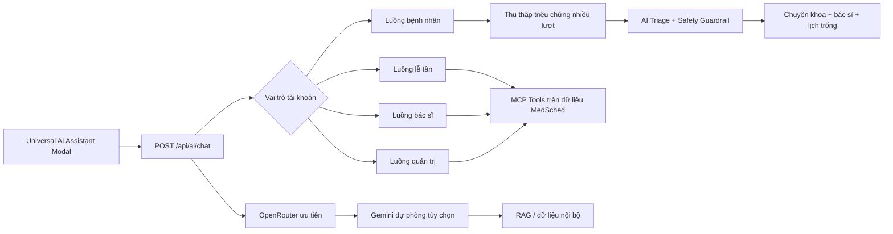

# Báo cáo hoàn thiện AI Chatbox MedSched — CLAB-132

## 1. Thông tin chung

- **Hạng mục:** Trợ lý AI đa nhiệm MedSched (MCP Protocol)
- **Nhánh phát triển:** `feature/clab-132-hoan-thien-ai-noi-bo-va-mcp`
- **Mục tiêu tích hợp:** `develop`
- **Phạm vi:** Frontend chatbox, điều phối backend theo vai trò, AI thật qua OpenRouter/Gemini, dữ liệu nội bộ dự phòng, công cụ MCP, gợi ý đặt lịch và chống spam.
- **Ngày tổng hợp:** 20/10/2026

## 2. Mục tiêu thực hiện

Hạng mục này nâng cấp chatbox từ giao diện hỏi đáp tĩnh thành trợ lý có khả năng:

1. Tự nhận đúng vai trò của tài khoản đăng nhập.
2. Không cho người dùng tự chọn hoặc sử dụng trợ lý của vai trò khác.
3. Hiểu hội thoại nhiều lượt và không hỏi lại thông tin bệnh nhân đã cung cấp.
4. Hỏi bổ sung khi triệu chứng chưa rõ, chỉ kết luận khi đủ dữ kiện.
5. Đưa ra chuyên khoa, bác sĩ, phí khám, phòng khám và lịch trống từ cơ sở dữ liệu thật.
6. Chuyển bệnh nhân sang trang đặt lịch với dữ liệu đã điền sẵn.
7. Trả lời câu hỏi ngoài nghiệp vụ bằng mô hình AI thật.
8. Tự dùng dữ liệu nội bộ khi nhà cung cấp AI hết hạn mức hoặc không phản hồi.
9. Hạn chế spam và bảo vệ endpoint AI bằng Bucket4j.

## 3. Kiến trúc tổng thể



### Thứ tự nhà cung cấp AI

1. **OpenRouter** — sử dụng `OPENROUTER_MODEL`, mặc định `openrouter/free`.
2. **Google Gemini** — nhà cung cấp dự phòng nếu được cấu hình.
3. **Internal RAG / Clinic Expert Engine** — bảo đảm chat không bị gián đoạn khi API ngoài lỗi, quá tải hoặc hết hạn mức.

Các khóa API chỉ được đọc từ `.env`. File `.env` đã được khai báo trong `.gitignore` và không được commit.

## 4. Phân quyền trợ lý theo tài khoản

| Vai trò đăng nhập | Trợ lý được kích hoạt | Nghiệp vụ chính |
| --- | --- | --- |
| `PATIENT` | Trợ lý bệnh nhân | Hỏi triệu chứng, sàng lọc, gợi ý chuyên khoa/bác sĩ/lịch khám |
| `STAFF` | Trợ lý lễ tân | Tra cứu bệnh nhân, tiếp đón, kiểm tra mã hẹn, hàng đợi |
| `DOCTOR` | Trợ lý bác sĩ | Xem ca khám, tóm tắt bệnh án, tra cứu thuốc, tham khảo phân luồng |
| `ADMIN` | Trợ lý quản trị | Thống kê, tài khoản, dữ liệu vận hành và báo cáo |

Backend đối chiếu vai trò gửi từ frontend với vai trò đã xác thực. Tài khoản không thể gọi chế độ trợ lý không thuộc quyền của mình.

## 5. Luồng hội thoại bệnh nhân

### 5.1. Thu thập dữ kiện theo nhiều lượt

Chatbox duy trì ngữ cảnh gần nhất và gom thông tin thành một đợt triệu chứng. Các nhóm dữ kiện chính gồm:

- vị trí đau hoặc vùng tổn thương;
- đặc điểm cảm giác;
- thời điểm bắt đầu và diễn tiến;
- mức độ;
- triệu chứng đi kèm;
- dấu hiệu nguy hiểm.

Thông tin đã trả lời không bị hỏi lại. Khi người dùng đổi sang triệu chứng khác, hệ thống tạo đợt hỏi mới thay vì tiếp tục câu hỏi cũ.

Ví dụ đã kiểm thử:

1. Bệnh nhân: “Bị ngứa da dị ứng nổi mẩn đỏ”.
2. AI: hỏi vùng tổn thương.
3. Bệnh nhân: “cổ”.
4. AI: chỉ hỏi thời gian, diễn tiến và mức độ còn thiếu.
5. Bệnh nhân: “Bắt đầu 2 ngày trước, xuất hiện đột ngột, mức độ vừa, không sốt và không khó thở”.
6. AI: xác định **Chuyên khoa Da liễu**, hiển thị bác sĩ và lịch đặt khám.

Các cụm phủ định như “không sốt” và “không khó thở” không còn bị hiểu nhầm thành triệu chứng dương tính.

### 5.2. Hỗ trợ đặt lịch sau sàng lọc

Khi đủ dữ kiện và không có dấu hiệu cấp cứu, backend trả về `PATIENT_BOOKING_SUPPORT`, bao gồm:

- mã và tên chuyên khoa;
- danh sách bác sĩ phù hợp từ MySQL;
- học hàm/học vị, phòng khám và phí khám;
- các khung giờ còn trống;
- đường dẫn tới trang đặt lịch;
- phần triệu chứng đã tổng hợp.

Frontend hiển thị thẻ gợi ý và nút **Đặt lịch khám**. Trang `/booking` nhận query parameters và tự điền chuyên khoa, bác sĩ, lịch gợi ý và mô tả triệu chứng.

### 5.3. Cảnh báo an toàn y tế

Các dấu hiệu nguy cấp như đau ngực dữ dội, khó thở dữ dội, mất ý thức, đột quỵ, nôn ra máu hoặc chấn thương nặng được kiểm tra trước khi gọi AI. Hệ thống ưu tiên khuyến cáo gọi **115** hoặc tới bệnh viện có cấp cứu, không tiếp tục quy trình đặt lịch ngoại trú.

Kết quả AI chỉ mang tính định hướng ban đầu, không thay thế chẩn đoán trực tiếp của bác sĩ.

## 6. Hỗ trợ theo vai trò nghiệp vụ

### 6.1. Lễ tân

- Tra cứu bệnh nhân theo tên, số điện thoại hoặc thông tin hồ sơ.
- Tìm bệnh nhân/lịch hẹn mới nhất trong ngày.
- Kiểm tra mã đặt lịch.
- Tiếp đón bệnh nhân và xem hàng đợi.
- Trả lời tự nhiên thay vì hiển thị JSON hoặc tên hàm nội bộ.

### 6.2. Bác sĩ

- Xem danh sách ca khám và hàng đợi trong ngày.
- Tóm tắt bệnh án theo mã lịch hẹn.
- Tra cứu thuốc hoặc hoạt chất trong danh mục.
- Phân tích triệu chứng để tham khảo chuyên khoa.

### 6.3. Quản trị viên

- Xem thống kê hôm nay, 7 ngày hoặc theo tháng.
- Xem tổng quan tài khoản đang hoạt động/bị khóa.
- Thống kê hồ sơ bệnh nhân, bác sĩ, thuốc và dữ liệu vận hành.
- Không chuyển nhầm câu hỏi quản trị sang công cụ sàng lọc bệnh nhân.

## 7. AI thật và cơ chế dự phòng

### 7.1. OpenRouter

Backend gọi API tương thích OpenAI tại `/chat/completions` thông qua `OpenRouterAiClient`.

Các biến cấu hình:

```env
OPENROUTER_API_KEY=
OPENROUTER_MODEL=openrouter/free
OPENROUTER_BASE_URL=https://openrouter.ai/api/v1
OPENROUTER_SITE_URL=http://localhost:3000
OPENROUTER_APP_NAME=MedSched AI
```

Trong quá trình kiểm thử, câu hỏi ngoài nghiệp vụ đã trả về `answerSource = OPENROUTER_API`.

### 7.2. Gemini dự phòng

Gemini vẫn được hỗ trợ tùy chọn qua:

```env
GEMINI_API_KEY=
GEMINI_MODEL=gemini-3.5-flash-lite
```

### 7.3. Dữ liệu nội bộ

Nếu API ngoài lỗi, hết hạn mức hoặc trả về dữ liệu không hợp lệ:

- câu hỏi chung được tra cứu từ kho kiến thức nội bộ;
- sàng lọc y tế dùng Clinic Expert Engine;
- hệ thống vẫn trả lời được mà không làm hỏng phiên chat.

## 8. Chống spam và bảo mật

`AiRequestGuard` sử dụng Bucket4j và áp dụng:

- giới hạn số yêu cầu theo cửa sổ thời gian;
- phát hiện gửi lặp nội dung trong khoảng ngắn;
- giới hạn độ dài tin nhắn;
- trả HTTP `429` và header `Retry-After` khi vượt giới hạn;
- nhận diện người dùng theo tài khoản xác thực, hoặc IP đối với bệnh nhân chưa đăng nhập.

Các biến cấu hình:

```env
AI_MAX_REQUESTS_PER_WINDOW=20
AI_WINDOW_SECONDS=60
AI_DUPLICATE_SECONDS=5
AI_MAX_MESSAGE_CHARS=2000
AI_MAX_IDENTITIES=10000
AI_CLEANUP_MILLIS=60000
```

## 9. Endpoint chính

| Method | Endpoint | Chức năng |
| --- | --- | --- |
| `POST` | `/api/ai/chat` | Chat đa vai trò, giữ ngữ cảnh và tự điều phối công cụ |
| `POST` | `/api/ai/triage` | Sàng lọc triệu chứng trực tiếp |
| `GET` | `/api/ai/tools` | Danh sách công cụ MCP |
| `POST` | `/api/ai/tools/execute` | Thực thi công cụ được phép theo vai trò |

## 10. Thành phần mã nguồn chính

### Backend

- `TriageController.java`: điều phối hội thoại và phân quyền theo vai trò.
- `MedSchedAiTools.java`: các MCP tool truy vấn nghiệp vụ thật.
- `OpenRouterAiClient.java`: kết nối OpenRouter.
- `GeminiGeneralAssistantService.java`: điều phối OpenRouter trước, Gemini sau.
- `SmartClinicAiTriageAdapter.java`: phân luồng y tế và safety guardrail.
- `InternalKnowledgeRagService.java`: truy xuất dữ liệu nội bộ dự phòng.
- `PatientBookingRecommendationService.java`: ghép chuyên khoa với bác sĩ và lịch trống.
- `AiRequestGuard.java`: chống spam bằng Bucket4j.

### Frontend

- `UniversalAiAssistantModal.tsx`: giao diện chat đa vai trò và thẻ đặt lịch.
- `FloatingWidgets.tsx`: nút mở chatbox dùng chung toàn hệ thống.
- `BookingForm.tsx`: nhận và điền trước gợi ý đặt lịch từ AI.
- Các màn hình bác sĩ, lễ tân, quản trị sử dụng cùng trợ lý nhưng được khóa theo quyền.

## 11. Kiểm thử đã thực hiện

- Backend compile thành công.
- Nhóm test `TriageControllerIntegrationTest` thành công.
- Test `AiRequestGuardTest` thành công.
- Test trực tiếp ba tầng fallback `SmartClinicAiTriageAdapter`, `GeminiGeneralAssistantService` và `InternalKnowledgeRagService` thành công.
- MCP contract test xác nhận endpoint thật và ngăn tái xuất hiện dữ liệu mock thành công.
- Frontend TypeScript kiểm tra thành công.
- Frontend production build thành công, bao gồm route `/booking`.
- Kiểm thử API OpenRouter thật: trả lời thành công và xác nhận nguồn `OPENROUTER_API`.
- Kiểm thử XAMPP/MySQL: backend kết nối thành công.
- Kiểm thử luồng bệnh nhân: Da liễu, 3 bác sĩ phù hợp và lịch gần nhất từ cơ sở dữ liệu.
- Kiểm thử website tại `http://localhost:3000`: HTTP 200.

## 12. Hạn chế và hướng phát triển

1. `openrouter/free` có thể chọn các model khác nhau nên chất lượng hoặc định dạng đầu ra có thể biến động; backend đã có validation và fallback.
2. Dữ liệu bác sĩ/lịch khám phụ thuộc dữ liệu thật đang có trong MySQL.
3. Cần bổ sung dashboard theo dõi số lần gọi AI, tỷ lệ fallback và lỗi theo nhà cung cấp.
4. Có thể bổ sung lưu phiên hội thoại có kiểm soát sau khi hoàn thiện chính sách dữ liệu y tế và quyền riêng tư.
5. Nên bổ sung kiểm thử end-to-end tự động cho toàn bộ luồng chat → gợi ý → đặt lịch.
6. Bucket4j hiện giới hạn theo từng tiến trình. Bản sửa đã dọn entry hết hạn và giới hạn số identity để tránh tăng bộ nhớ vô hạn; khi triển khai nhiều instance cần chuyển trạng thái rate limit sang Redis hoặc API Gateway dùng chung.

## 13. Kết quả rà soát kỹ thuật bổ sung

- MCP đã bỏ toàn bộ fallback giả lập; tra lịch, check-in, thống kê và thanh toán chỉ báo thành công khi API MedSched thật thành công.
- Dependency/config Spring AI không sử dụng đã được loại bỏ; OpenRouter và Gemini tiếp tục được gọi qua các client REST hiện có.
- Kết quả chuyên khoa hợp lệ do AI trả về được bảo toàn; ánh xạ theo nhóm triệu chứng chỉ còn là fallback cho mã thiếu hoặc không được MedSched hỗ trợ.
- Mail, Brevo và PayOS chỉ nhận credential từ biến môi trường. Các khóa từng xuất hiện trong lịch sử Git phải được thu hồi và tạo lại trước khi triển khai.
- So khớp triệu chứng hỗ trợ cả tiếng Việt có dấu/không dấu; rule y tế xác định vẫn được giữ làm guardrail an toàn.

## 14. Kết luận

AI Chatbox MedSched đã hoàn thành các mục tiêu chính của CLAB-132: đa vai trò, hội thoại tự nhiên, hỏi bổ sung theo ngữ cảnh, kết nối AI thật, fallback nội bộ, bảo vệ chống spam và chuyển kết quả sàng lọc thành hành động đặt lịch cụ thể. Hệ thống hiện có thể chạy trên môi trường phát triển với frontend cổng `3000`, backend cổng `8080` và MySQL/XAMPP.
